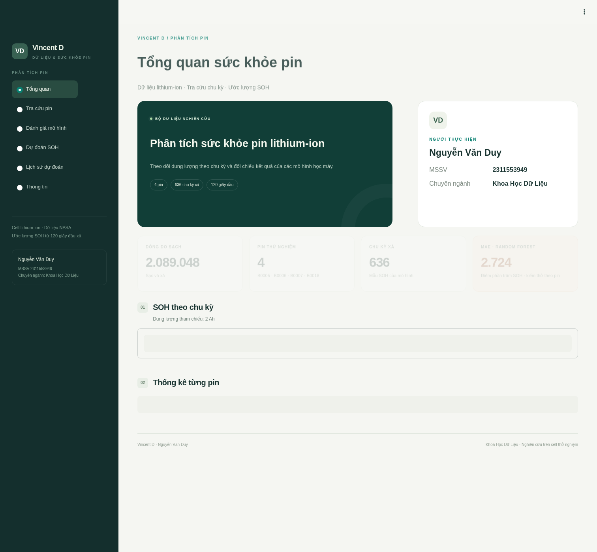

# Khóa luận: Phân tích và dự đoán tình trạng sức khỏe pin xe điện bằng các mô hình học máy

Nguyễn Văn Duy · MSSV 2311553949 · Lớp 23DTH2A · GVHD theo phiếu: ThS. Vương Xuân Chí.

Sản phẩm dùng **Python 3.12, pandas, scipy, scikit-learn, matplotlib và Streamlit**. Code dùng hàm, vòng lặp và mô hình có sẵn của thư viện; có tài liệu giải thích để sinh viên chạy lại và bảo vệ.

**Để học và chuẩn bị bảo vệ:** đọc [Sổ tay hiểu code, mô hình và kết quả](docs/so-tay-hoc-va-bao-ve.md), hoặc tải [bản Word](docs/so-tay-hoc-va-bao-ve.docx?raw=true). Sổ tay có quy trình từng bước, giải thích các đoạn code, ưu/nhược điểm của năm cấu hình, số liệu thật, lỗi Windows và kịch bản trả lời hội đồng. Chạy `python scripts/build_study_guide.py` để tạo lại các bảng của sổ tay từ kết quả mới.

## Tải về

- [Code, mô hình, dữ liệu xả, notebook, báo cáo Word và slide](delivery/KhoaLuan_NguyenVanDuy.zip?raw=true).
- [Dataset sạch đầy đủ 2.089.048 dòng](delivery/Dataset_Pin_NASA_2tr_dong.zip?raw=true).

Gói dataset tách riêng để không phải tải dữ liệu lớn khi chỉ xem code. SHA-256 nằm cạnh từng ZIP. Nếu GitHub không tự tải, chọn **Download raw file**. Bộ code không kèm `.venv`; vẫn cần cài Python/thư viện.

## Chạy sản phẩm trên Windows / VS Code

Mở đúng thư mục có README này, không mở terminal ở trong `app`. Cài Python 3.12 rồi mở PowerShell:

```powershell
py -3.12 --version
powershell -ExecutionPolicy Bypass -File .\chay_windows.ps1
```

Nếu chưa có 3.12, cài bằng `py install 3.12` khi Python Install Manager hỗ trợ, hoặc tải Python 3.12 từ python.org. Script chạy từng bước và dừng ngay khi có lỗi. Lần đầu phải đợi pip cài xong; không bấm Ctrl+C. Tham số ExecutionPolicy chỉ áp dụng tiến trình chạy script này.

Chạy thủ công nếu muốn học từng bước:

```powershell
py -3.12 -m venv .venv
.\.venv\Scripts\python.exe -m pip install -r requirements-app.txt
.\.venv\Scripts\python.exe scripts\download_data.py
.\.venv\Scripts\python.exe scripts\prepare_data.py
.\.venv\Scripts\python.exe scripts\run_experiment.py
.\.venv\Scripts\python.exe -m streamlit run app\streamlit_app.py
```

Sau lần chuẩn bị thành công, chỉ cần lệnh cuối để mở ứng dụng. Khi chạy trên máy cá nhân, mở địa chỉ localhost mà Streamlit in ra, thường là cổng 8501. Dừng bằng Ctrl+C.

## Chạy toàn bộ nghiên cứu và tạo lại tài liệu

Linux: `bash scripts/setup.sh`. Windows: cài `requirements.txt` thay cho `requirements-app.txt`, rồi chạy thêm `scripts/check_dataset.py`, `scripts/analyze_results.py`, `python -m pytest -q`, `scripts/build_notebook.py` và `scripts/build_documents.py` bằng Python của `.venv`.

Cần khoảng 2 GB ổ đĩa cho môi trường và CSV. Không cần GPU hoặc API key. `requirements-app.txt` chỉ cài phần chạy sản phẩm; `requirements.txt` thêm kiểm thử và xuất Word/PowerPoint/notebook; `requirements.lock.txt` ghim môi trường Linux đã kiểm thử. Script Windows đã được kiểm tra nội dung nhưng chưa được thực thi trực tiếp trên Windows trong môi trường Linux này.

## Giao diện Vincent D

Thông tin hiển thị: **Nguyễn Văn Duy · MSSV 2311553949 · Chuyên ngành Khoa Học Dữ Liệu**.

| Mục | Chức năng |
| --- | --- |
| Tổng quan | Hồ sơ sinh viên, số liệu nghiên cứu, đường SOH của bốn pin |
| Tra cứu pin | Lọc pin/chu kỳ, xem tín hiệu và so sánh hai chu kỳ A/B, tải CSV |
| Đánh giá mô hình | So sánh MAE/RMSE/R², chọn mô hình và pin kiểm thử, xem sai số, phân tích bổ sung |
| Dự đoán SOH | Một chu kỳ hoặc theo lô tối đa 100 chu kỳ; lỗi theo nhóm; xuất CSV và phiếu HTML |
| Lịch sử dự đoán | Lưu tạm tối đa 500 chu kỳ trong phiên, lọc trạng thái, tải hoặc xóa |
| Thông tin | Nguồn, quy trình làm sạch, thuật ngữ và tải báo cáo/slide |

Biểu đồ tương tác và bảng trình bày dùng tiếng Việt; CSV xuất cho Excel có BOM để đọc đúng dấu. Trang dự đoán nhận cả tên cột gốc lẫn tên tiếng Việt đã xuất từ ứng dụng. File phải thuộc đúng một pin và một chu kỳ. Giao diện dùng Arial, hiệu ứng nhẹ và hỗ trợ giảm chuyển động. Không hiển thị các đoạn hướng dẫn học/bảo vệ; tài liệu học được giữ riêng trong docs. Phiếu HTML có thể mở bằng trình duyệt và in/lưu PDF, không cần mạng ngoài.

Code giao diện tách theo nhiệm vụ: `app/screens/` chứa sáu màn hình; `app/charts.py` tạo biểu đồ; `app/labels.py` dịch cột; `app/prediction.py` kiểm tra CSV; `app/styles.css` phụ trách màu sắc/bố cục. Giao diện không huấn luyện lại mô hình khi người khác xem.



## Dataset đã kiểm tra

| Nội dung | Số lượng |
| --- | ---: |
| Dòng sạc/xả ban đầu | 2.089.050 |
| Dòng sạc thiếu tín hiệu bị loại | 2 |
| Dòng sạch | **2.089.048** |
| Trong đó: dòng sạc sạch | 1.903.327 |
| Trong đó: dòng xả | 185.721 |
| Mẫu học máy theo chu kỳ xả | **636** |
| Pin độc lập | **4** |

Không nhân bản, không nội suy để tăng dòng. Không thiếu/vô hạn hoặc trùng khóa sau làm sạch. `scripts/check_dataset.py` kiểm tra CSV theo khối và so các mảng với MATLAB. Xem [từ điển dữ liệu và nguồn](data/README.md).

NASA là nguồn thí nghiệm Hoa Kỳ; **không phải dữ liệu Việt Nam**. File MATLAB từ bản lưu công khai dẫn nguồn NASA, ghim commit và checksum. Danh mục NASA và mô tả thí nghiệm đã được đọc; chưa xác thực byte với archive S3 của đơn vị phát hành. Hơn hai triệu dòng đo vẫn chỉ là bốn pin, không phải hai triệu mẫu SOH độc lập.

## Mô hình và kết quả hiện tại

- SOH (%) = 100 × dung lượng xả / 2 Ah. Giữ nguyên giá trị hơi trên 100% nếu dung lượng đo vượt danh định.
- 11 đặc trưng: số chu kỳ và thống kê điện áp, dòng, nhiệt độ trong 120 giây đầu xả. Không dùng capacity hoặc SOH làm đầu vào.
- Giữ riêng từng pin để test: 4 vòng, 5 mô hình, 20 lần fit. Không chia ngẫu nhiên thời điểm trong cùng pin.
- Random Forest: macro MAE **2,724**, RMSE **3,189** điểm phần trăm SOH. Cycle Ridge: MAE **4,074**.
- Đã có phân tích bỏ đặc trưng và kiểm thử 70/30 theo thời gian. Trong thiết kế thời gian, RF kém baseline SOH cuối đã biết; không tuyên bố dự báo RUL.

Các số 1,24 ở phiên bản ba pin cũ không mô tả bộ bốn pin hiện tại. Mô hình demo fit lại cả bốn pin nên dự đoán CSV mẫu không phải điểm test độc lập.

## Cấu trúc dễ theo dõi

| File / thư mục | Vai trò |
| --- | --- |
| `scripts/download_data.py` | Tải dữ liệu và kiểm tra checksum |
| `scripts/prepare_data.py` | Đọc MATLAB, làm sạch, xuất CSV và đặc trưng |
| `scripts/check_dataset.py` | Kiểm chứng toàn bộ dataset |
| `src/battery_soh/features.py` | Đặc trưng 120 giây dùng chung |
| `scripts/run_experiment.py` | Huấn luyện, kiểm thử và lưu mô hình |
| `scripts/analyze_results.py` | Bỏ đặc trưng, đánh giá theo thời gian |
| `app/streamlit_app.py` | Giao diện dữ liệu, kết quả và dự đoán CSV |
| `notebooks/01_eda.ipynb` | Notebook đã thực thi |
| `docs/giai-thich-code.md` | Giải thích từng bước và cách trình bày |
| `docs/bao-cao-khoa-luan.docx` | Báo cáo có kết quả thực nghiệm |
| `docs/slide-bao-ve.pptx` | Slide bảo vệ |
| `reports/` | Thống kê, chỉ số, dự đoán test, hình và nhật ký |

Không nhận mô hình joblib từ nguồn không tin cậy. Kết quả chỉ được kiểm chứng trên cell thử nghiệm, chưa trên pack/xe điện Việt Nam. Sinh viên cần kiểm tra, hiểu và trao đổi với giảng viên về mẫu trường, tài liệu chuyên ngành và tiêu chí nghiệm thu trước bản nộp chính thức.
