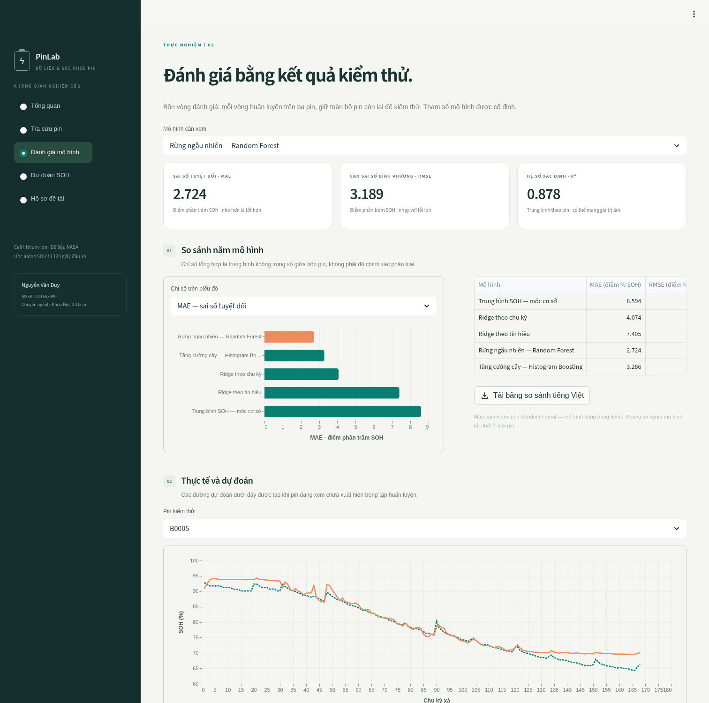
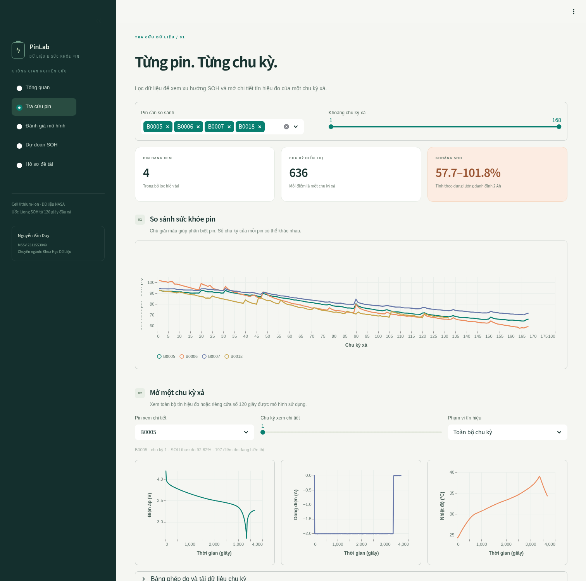
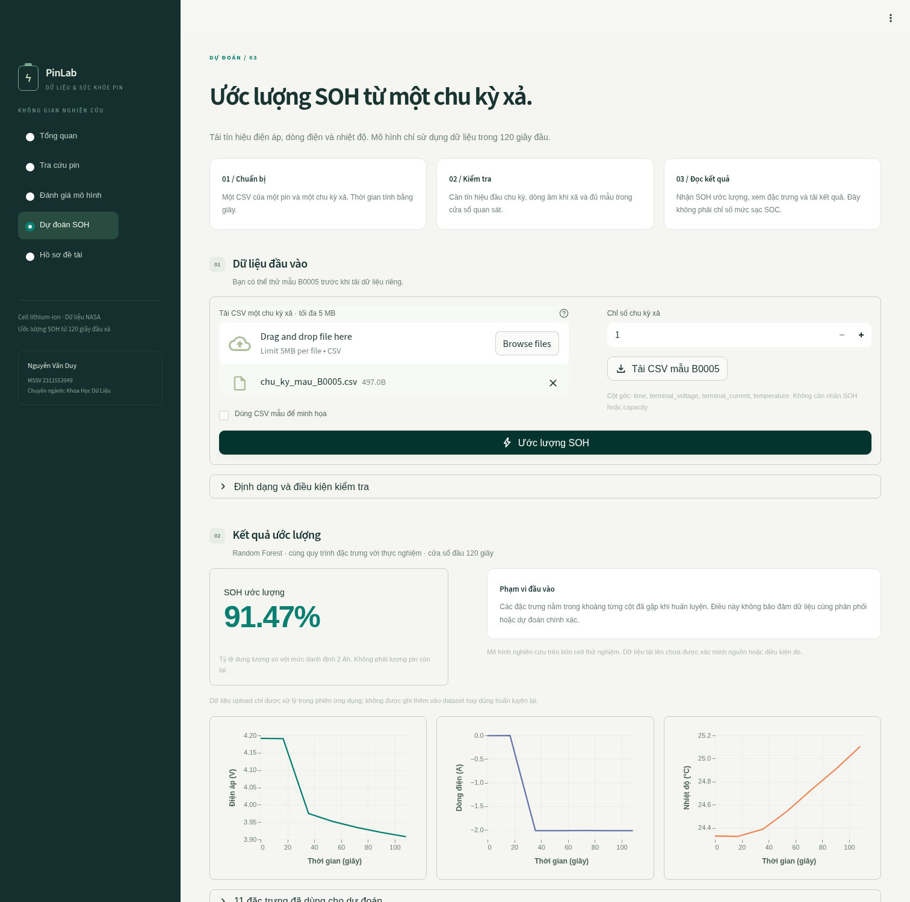

# PHÂN TÍCH VÀ DỰ ĐOÁN TÌNH TRẠNG SỨC KHỎE PIN XE ĐIỆN BẰNG CÁC MÔ HÌNH HỌC MÁY

Trường Đại học Nguyễn Tất Thành — Khoa Công nghệ thông tin

Sinh viên: Nguyễn Văn Duy — MSSV: 2311553949 — Lớp: 23DTH2A

Giảng viên hướng dẫn theo phiếu đăng ký: ThS. Vương Xuân Chí

**Báo cáo nghiên cứu để sinh viên kiểm tra và trao đổi với giảng viên. Chưa có mẫu trình bày chính thức hoặc xác nhận nghiệm thu.** Không tạo thay chữ ký, nhận xét, lời cam đoan hoặc kết quả phê duyệt.

## Tóm tắt

Khóa luận xây dựng một sản phẩm ước lượng trạng thái sức khỏe (State of Health — SOH) của cell lithium-ion từ dữ liệu đo đầu chu kỳ xả. Dữ liệu được đọc trực tiếp từ bốn file MATLAB công khai dẫn nguồn NASA. Tổng số bản ghi sạc/xả ban đầu là 2.089.050; sau khi loại hai bản ghi sạc thiếu tín hiệu, còn 2.089.048 bản ghi sạch. Bảng đặc trưng cho mô hình gồm 636 chu kỳ xả thuộc bốn pin, không phải hai triệu mẫu SOH độc lập. Đặc trưng sử dụng điện áp, dòng điện, nhiệt độ trong 120 giây đầu và chỉ số chu kỳ. Năm mô hình được đánh giá bằng cách giữ riêng từng pin làm kiểm thử. Random Forest đạt MAE trung bình {{RF_MAE}} và RMSE {{RF_RMSE}} điểm phần trăm SOH. Các phân tích bổ sung gồm bỏ nhóm đặc trưng và chia theo thời gian. Sản phẩm gồm quy trình dữ liệu, mô hình, ứng dụng Streamlit, notebook, kiểm thử, báo cáo và tài liệu tái lập. Kết quả giới hạn ở các cell thử nghiệm; chưa chứng minh hiệu quả trên bộ pin xe điện thực tế hoặc dữ liệu Việt Nam.

Từ khóa: pin lithium-ion, SOH, học máy, Random Forest, chất lượng dữ liệu, kiểm thử theo nhóm.

## Abstract

This thesis implements a reproducible lithium-ion cell state-of-health estimation workflow. Four publicly mirrored MATLAB files attributed to the NASA PCoE battery dataset yield 2,089,048 valid charge and discharge measurements after removing two incomplete charging records. The supervised SOH table contains 636 discharge-cycle samples from four cells. Features are extracted from the first 120 seconds of discharge, without using full-cycle capacity as an input. Five fixed-parameter models are evaluated using leave-one-battery-out validation. Random Forest obtains a macro MAE of {{RF_MAE}} SOH percentage points. Additional analyses examine feature removal and forward chronological evaluation. The deliverables include a data pipeline, a Streamlit demonstration, executed notebooks, tests, and reproducibility documentation. These results do not establish field performance on electric-vehicle battery packs.

## Danh mục từ viết tắt

| Từ viết tắt | Ý nghĩa | Vai trò trong khóa luận |
| --- | --- | --- |
| SOH | State of Health | Sức khỏe theo dung lượng so với 2 Ah |
| SOC | State of Charge | Trạng thái sạc; không phải biến đích |
| RUL | Remaining Useful Life | Tuổi thọ còn lại; ngoài phạm vi thực nghiệm |
| CC/CV | Constant Current / Constant Voltage | Chế độ sạc trong mô tả dữ liệu |
| MAE | Mean Absolute Error | Sai số tuyệt đối trung bình |
| RMSE | Root Mean Squared Error | Căn sai số bình phương trung bình |
| RF | Random Forest | Mô hình cây dùng cho demo |
| LOBO | Leave-One-Battery-Out | Giữ riêng toàn bộ từng pin để kiểm thử |

## Chương 1. Giới thiệu

### 1.1. Bối cảnh

Dung lượng sử dụng được của pin lithium-ion thay đổi theo quá trình sử dụng. Việc mô tả tình trạng sức khỏe pin là một bài toán liên quan quản lý năng lượng, bảo trì và đánh giá khả năng vận hành. Khi nghiên cứu bằng dữ liệu, cần phân biệt mức sạc tại một thời điểm với dung lượng tối đa mà cell có thể cung cấp. Hai cell đều ở trạng thái sạc đầy vẫn có thể có dung lượng thực tế khác nhau.

Trong điều kiện thử nghiệm, dung lượng xả của một chu kỳ được dùng làm giá trị tham chiếu để tính SOH. Tuy nhiên, quan sát hết chu kỳ xả mới có được giá trị đó. Khóa luận đặt vấn đề sử dụng một phần ngắn của tín hiệu đầu chu kỳ để ước lượng sức khỏe. Cách tiếp cận phù hợp một sản phẩm minh họa khoa học dữ liệu vì có thể thiết kế rõ đầu vào, nhãn, quy trình đánh giá và giới hạn.

### 1.2. Vấn đề nghiên cứu

Câu hỏi chính là: tín hiệu trong 120 giây đầu chu kỳ xả có giúp mô hình ước lượng SOH của một pin chưa xuất hiện trong huấn luyện tốt hơn mô hình chỉ sử dụng chỉ số chu kỳ không? Thời điểm đưa ra dự đoán là sau cửa sổ quan sát đó, không phải trước khi xả.

Hai câu hỏi bổ sung là vai trò của số chu kỳ và nhiệt độ trong mô hình cây, và khả năng dự đoán các chu kỳ về sau khi đã có nhãn những chu kỳ đầu của cùng một pin. Câu hỏi sau có thiết kế khác với kiểm thử trên pin mới, vì vậy kết quả phải được báo cáo riêng.

### 1.3. Mục tiêu

Mục tiêu kỹ thuật là xây dựng một quy trình dễ đọc bằng Python và các thư viện thông dụng: scipy để đọc MATLAB; pandas/NumPy để xử lý bảng; scikit-learn để huấn luyện; matplotlib để vẽ hình; Streamlit để làm giao diện. Không triển khai mạng học sâu hoặc thuật toán tối ưu tự viết vì phạm vi dữ liệu nhãn nhỏ và mục tiêu là một quy trình sinh viên có thể giải thích.

Mục tiêu nghiên cứu gồm kiểm tra nguồn, làm sạch minh bạch, chống rò rỉ dữ liệu, so sánh nhiều mô hình với baseline, phân tích lỗi theo từng pin và trình bày được điều mà kết quả chứng minh cũng như điều chưa được chứng minh.

### 1.4. Phạm vi và sản phẩm

Nguồn dữ liệu gồm bốn cell B0005, B0006, B0007 và B0018 theo README thí nghiệm. Khóa luận không có số đo vận hành trên xe ở Việt Nam. Phần sạc được xuất để tạo bộ dữ liệu đầy đủ và phục vụ khám phá; mô hình SOH chính chỉ sử dụng cửa sổ xả có dung lượng tham chiếu.

Sản phẩm bàn giao gồm CSV sạch trên hai triệu dòng, bảng 636 mẫu học máy, mã nguồn, mô hình demo, nhật ký kiểm tra, kết quả theo từng pin, ứng dụng, notebook đã chạy, báo cáo Word và slide. Việc đóng gói đủ các thành phần này không thay thế xác nhận nghiệm thu hoặc yêu cầu hình thức của trường.

### 1.5. Đóng góp trong phạm vi khóa luận

Đóng góp thực hiện là quy trình đọc trực tiếp cấu trúc MATLAB, kiểm chứng từng mảng sau khi xuất CSV, tách rõ dòng đo và mẫu nhãn, kiểm thử theo pin và một ứng dụng dùng đúng mã đặc trưng đã đánh giá. Không tuyên bố phát minh Random Forest, đề xuất thuật toán mới hoặc đạt hiệu quả tốt nhất so với mọi công trình SOH.

## Chương 2. Cơ sở lý thuyết và tài liệu liên quan

### 2.1. Dữ liệu lão hóa pin NASA

Danh mục NASA PCoE mô tả dữ liệu pin với thí nghiệm sạc, xả và trở kháng, và ghi trích dẫn Saha và Goebel (2007) [1]. Trang danh mục đã đọc được trong lần triển khai hiện tại. File tải trên S3 do trang đó chỉ dẫn chưa truy cập được; vì vậy file MATLAB thực tế được lấy từ một bản lưu công khai, cố định commit và checksum [2]. Cần phân biệt dữ liệu định dạng MATLAB của bản lưu với việc đã xác nhận byte từ máy chủ phát hành.

README đi kèm bốn pin mô tả sạc CC 1,5 A tới 4,2 V, sau đó CV tới ngưỡng dòng 20 mA; xả CC khoảng 2 A với các ngưỡng điện áp cuối khác nhau giữa pin. Đây là thông tin giúp hiểu dữ liệu và cũng là giới hạn: điều kiện phòng thí nghiệm không thể tự động đại diện cho dòng tải, môi trường và quản lý nhiệt của xe thực tế.

### 2.2. SOH, SOC và RUL

SOH theo dung lượng được tính bằng tỷ số dung lượng tham chiếu đo được so với dung lượng danh định. Trong khóa luận: SOH (%) = 100 × Q / Q_nominal, với Q_nominal = 2 Ah theo README. SOC thể hiện lượng điện còn lại tương đối trong một chu kỳ; RUL là phần tuổi thọ còn lại tới một tiêu chí kết thúc. Ba đại lượng không được dùng thay thế nhau.

Giá trị SOH có thể hơi lớn hơn 100% nếu dung lượng đo ban đầu vượt mức danh định. B0006 có giá trị tối đa khoảng 101,77%; quy trình giữ nguyên và giải thích theo định nghĩa, không cắt nhãn để đồ thị đẹp hơn. Chỉ loại nhãn không hợp lệ như thiếu, không hữu hạn hoặc không nhất quán trong cùng chu kỳ.

### 2.3. Hồi quy Ridge

Ridge mở rộng hồi quy tuyến tính bằng hạng phạt L2 trên hệ số. Hàm mục tiêu gồm tổng bình phương sai số cộng alpha nhân tổng bình phương hệ số. Khi đặc trưng có thang đo khác nhau, chuẩn hóa giúp việc điều chuẩn có ý nghĩa hơn. Tài liệu scikit-learn đã đọc giải thích dạng hàm mục tiêu và cách sử dụng Ridge [3].

Khóa luận sử dụng Cycle Ridge với một đầu vào số chu kỳ như baseline có xu hướng; Signal Ridge dùng toàn bộ đặc trưng. Không giả định thêm nhiều đặc trưng luôn cải thiện mô hình tuyến tính. Hệ số chuẩn hóa chỉ được học từ tập huấn luyện, không từ pin kiểm thử.

### 2.4. Random Forest và boosting

Random Forest kết hợp dự đoán từ nhiều cây để mô tả quan hệ phi tuyến. Tài liệu ensemble của scikit-learn dẫn công trình Breiman (2001), Random Forests, Machine Learning 45(1), trang 5–32 [4]. Khóa luận sử dụng hiện thực thư viện, không tự viết lại thuật toán. Số cây và số mẫu tối thiểu tại lá được cố định nhằm giới hạn độ phức tạp và giữ tính tái lập.

HistGradientBoosting là mô hình cây cộng dồn với cách chia giá trị đặc trưng theo histogram. Tài liệu thư viện dẫn Friedman (2001), Greedy Function Approximation: A Gradient Boosting Machine [5]. Mô hình được đưa vào để so sánh một phương pháp phi tuyến khác, không vì đã biết nó sẽ tốt nhất trên dữ liệu này.

Các công trình [4], [5] được dùng ở đây như nền tảng thuật toán theo tài liệu thư viện; không trình bày chúng như công trình đã nghiên cứu trực tiếp bộ pin của khóa luận. Tổng quan SOH chuyên ngành rộng hơn vẫn cần được giảng viên xác định phạm vi và sinh viên đọc bổ sung trước bản nộp chính thức.

### 2.5. Đánh giá theo nhóm và theo thời gian

Tài liệu cross-validation của scikit-learn mô tả LeaveOneGroupOut để loại toàn bộ một nhóm khỏi phần huấn luyện [6]. Trong khóa luận, nhóm là mã pin. Việc chia ngẫu nhiên các dòng đo hoặc chu kỳ cùng pin làm train/test có nguy cơ đo khả năng nội suy trong cùng pin, không đo khả năng áp dụng cho pin mới.

Đánh giá theo thời gian trả lời một câu hỏi khác: mô hình biết các chu kỳ đầu của cùng pin và cần dự đoán chu kỳ sau. Khi đó, chỉ số chu kỳ kiểm thử có thể nằm ngoài khoảng huấn luyện; mô hình cây thường khó ngoại suy xu hướng. Baseline dùng SOH cuối cùng đã biết được đưa vào để kiểm tra xem học máy có cải thiện hơn một cách dự đoán đơn giản không.

### 2.6. Chỉ số sai số

Với sai số e_i = y_pred_i − y_i, MAE = trung bình |e_i| và RMSE = căn bậc hai của trung bình e_i². MAE dễ diễn giải, RMSE nhạy hơn với sai số lớn. R² = 1 − SSE/SST so sánh sai số với độ biến thiên của tập kiểm thử và có thể âm.

Do y được tính trên thang SOH nhân 100, MAE/RMSE có đơn vị điểm phần trăm SOH. MAE 2,7 không được viết thành độ chính xác 97,3%. Kết quả chính lấy trung bình không trọng số giữa bốn pin, nên mỗi pin có vai trò bằng nhau dù số chu kỳ không bằng nhau.

## Chương 3. Dữ liệu và phương pháp thực hiện

### 3.1. Nguồn dữ liệu và phiên bản

File MATLAB được tải từ repository psanabriaUC/BatteryDatasetImplementation, commit 0007aead10cb85aafdd11fb3de1d64186c7c6c05 [2]. Manifest lưu URL và SHA-256 của B0005.mat, B0006.mat, B0007.mat, B0018.mat cùng README. Checksum giúp xác nhận lại phiên bản bản lưu, không tự chứng minh danh tính nội dung từ S3 chính thức.

Bản CSV cộng đồng từng dùng ở giai đoạn đầu cũng được đối chiếu với MATLAB của ba pin tương ứng. Có 468 chu kỳ khớp số mẫu, thời gian, điện áp và dung lượng. Hai nguồn đều có một số trục thời gian giống nhau giữa pin; vì vậy không đủ cơ sở coi đây là lỗi riêng của bước chuyển đổi CSV. Nhật ký đối chiếu được giữ trong reports/source_comparison.csv.

### 3.2. Kiểm kê và làm sạch

Tổng đầu vào sạc/xả là 2.089.050 bản ghi. Hai bản ghi sạc tại B0018, operation_index 115, thời gian 4528.156 và 4786.328 giây bị thiếu điện áp, dòng và nhiệt độ. Các bản ghi này không dùng được để phân tích tín hiệu nên bị loại và ghi nhật ký. Không có bản ghi được sinh thêm để bù; bộ sạch còn 2.089.048 dòng.

{{AUDIT_TABLE}}

Số liệu ở cột rows là dòng xả dùng xây dựng nhãn; all_rows gồm cả sạc và xả. Sau làm sạch, bảng toàn bộ phép đo không còn giá trị thiếu/vô hạn hoặc khóa trùng. Khóa được xác định bằng battery, operation_index và time; không thể chỉ dùng time vì thời gian bắt đầu lại ở mỗi operation.

Không ghép trở kháng vào bảng tín hiệu vì cấu trúc đo khác. Không đồng nhất chỉ số sạc và xả: ở ba pin đầu có 170 lần sạc và 168 lần xả. Cột cycle được đếm riêng theo loại hoạt động; operation_index giữ vị trí thật trong cấu trúc gốc.

### 3.3. Hai cấp độ dữ liệu

Bảng measurements_all.csv gồm 2.089.048 dòng và chín cột: battery, operation_type, operation_index, cycle, time, terminal_voltage, terminal_current, temperature, ambient_temperature. Bảng này không tự gán SOH cho các dòng sạc. Bảng measurements.csv chỉ gồm 185.721 dòng xả, bổ sung capacity và SOH tỷ lệ.

Bảng cycle_features.csv gồm 636 dòng và 13 cột: mã pin, nhãn soh_pct và 11 đặc trưng. Số mẫu của bài toán hồi quy là 636 chu kỳ; số nhóm độc lập là bốn pin. Không sử dụng con số hai triệu để tuyên bố số mẫu giám sát hoặc độ đa dạng pin tăng lên.

### 3.4. Xây dựng nhãn và cửa sổ

Mỗi chu kỳ xả có một dung lượng tham chiếu. Nhãn được kiểm tra hữu hạn, dương, nhất quán trong chu kỳ và SOH = capacity/2 trong sai số 10⁻⁶. Biến đích của mô hình là soh_pct, bằng SOH nhân 100.

Cửa sổ đầu vào là 0–120 giây tính từ mốc đầu bản ghi, không dịch mốc tới lần xuất hiện dòng xả. Cần ít nhất năm mẫu; mốc đầu không muộn hơn 20 giây và mốc cuối trong cửa sổ không sớm hơn 90 giây. Cần ít nhất ba mẫu có dòng nhỏ hơn −0,1 A trải dài ít nhất 30 giây. Các điều kiện bảo đảm cửa sổ chứa thông tin xả tối thiểu, không khẳng định 120 giây là cửa sổ tối ưu.

Có 636 chu kỳ xả vượt kiểm tra, không loại chu kỳ xả nào. Các bước này không loại hai bản ghi sạc bằng cách xóa cả chu kỳ xả hoặc chuyển chúng thành nhãn, nên số mẫu giám sát không bị giảm do hai bản ghi thiếu ở phần sạc.

### 3.5. Đặc trưng

| Nhóm | Các đặc trưng | Diễn giải |
| --- | --- | --- |
| Lịch sử | cycle | Chỉ số chu kỳ xả hiện tại |
| Điện áp | mean, min, max, std, slope | Mức và thay đổi điện áp trong cửa sổ |
| Dòng | mean, std | Mức tải xả và biến thiên đo được |
| Nhiệt độ | mean, max, slope | Trạng thái nhiệt và xu hướng đầu chu kỳ |

Độ lệch chuẩn dùng ddof=0. Độ dốc lấy hệ số đường thẳng fit theo thời gian. Tất cả thống kê tín hiệu được tính trên các mẫu xả đã chọn trong cửa sổ. Không dùng capacity, SOH, tích phân dòng toàn chu kỳ hoặc thời gian kết thúc xả làm đầu vào.

Mã trích xuất được dùng chung giữa thực nghiệm và ứng dụng. Kiểm thử thay nhãn và tín hiệu sau 120 giây nhưng yêu cầu đặc trưng không đổi; kiểm thử khác xác nhận mẫu ở đúng 120 giây vẫn nằm trong cửa sổ.

### 3.6. Thiết kế thực nghiệm chính

Năm cấu hình cố định gồm Mean baseline, Cycle Ridge, Signal Ridge, Random Forest và HistGradientBoosting. Mỗi vòng giữ riêng một pin; phần còn lại dùng huấn luyện. Có bốn vòng, tổng cộng 20 lần fit phục vụ đánh giá chính. Không tìm kiếm siêu tham số trên các pin kiểm thử.

| Mô hình | Cấu hình |
| --- | --- |
| Mean baseline | Trung bình nhãn huấn luyện |
| Cycle Ridge | StandardScaler; alpha=1; đầu vào cycle |
| Signal Ridge | StandardScaler; alpha=10; 11 đầu vào |
| Random Forest | 200 cây; min_samples_leaf=5; seed=42; n_jobs=2 |
| HistGradientBoosting | 150 vòng; 15 lá tối đa; L2=1; không early stopping; seed=42 |

Mô hình demo được quy định là Random Forest từ trước; sau khi đánh giá, fit lại trên cả bốn pin để phục vụ ứng dụng. Không dùng dự đoán mẫu demo đã học để tính chỉ số kiểm thử. Việc lựa chọn tham số mới sau khi nhìn các kết quả này phải được coi là nghiên cứu tiếp nối và cần validation độc lập.

### 3.7. Thực nghiệm bổ sung

Phân tích bỏ đặc trưng dùng Random Forest với ba cấu hình: toàn bộ, bỏ cycle, bỏ nhiệt độ. Mục đích là tìm hiểu độ nhạy của kết quả với nhóm đầu vào, không chọn lại mô hình demo hoặc tuyên bố tối ưu sau khi biết điểm.

Kiểm thử thời gian dùng 70% chu kỳ đầu của mỗi pin để học và 30% còn lại để đánh giá. Baseline Last known SOH dùng nhãn cuối cùng trong phần train để dự đoán cho các chu kỳ test; không dùng nhãn test hoặc SOH tương lai. Kết quả của bốn pin được trình bày riêng, không trộn vào bảng LOBO.

## Chương 4. Kết quả và thảo luận

### 4.1. Kết quả chính

{{SUMMARY_TABLE}}

Random Forest có macro MAE {{RF_MAE}} và RMSE {{RF_RMSE}} điểm phần trăm. Cycle Ridge có MAE {{CYCLE_MAE}}. Mức giảm MAE tương đối là khoảng {{MAE_REDUCTION}}%, tính theo hai chỉ số này. Mean baseline không mô tả đủ biến thiên SOH của từng pin. Kết quả không phải bằng chứng rằng RF luôn hơn mô hình tuyến tính ở mọi pin hoặc mọi chế độ tải.

### 4.2. Kết quả theo pin

{{BY_BATTERY_TABLE}}

B0006 là trường hợp RF có sai số lớn hơn các pin còn lại trong thiết kế hiện tại. Đây là pin bổ sung so với bản thực nghiệm ba pin ban đầu, làm thay đổi cả tập train của các vòng khác. Không sử dụng điểm số 1,24 của bản ba pin cũ để mô tả bộ bốn pin mới. Việc mở rộng dữ liệu có thể làm chỉ số xấu đi nhưng phản ánh bài toán khó hơn.

Ở B0005, Cycle Ridge có MAE thấp hơn RF. Signal Ridge thất bại rõ ở B0007, có R² âm, cho thấy quan hệ tuyến tính của các tín hiệu và điều kiện giữa pin không ổn định theo cấu hình này. Không ẩn các cấu hình kém hoặc chỉ báo cáo pin tốt nhất.

### 4.3. Phân tích lỗi

Đồ thị dự đoán so với nhãn có đường tham chiếu y=x; độ lệch khỏi đường này biểu thị sai số. Biểu đồ sai số theo chu kỳ cho phép quan sát thiên lệch theo giai đoạn sử dụng. Mỗi điểm là một dự đoán kiểm thử, không phải dự đoán từ mô hình fit cả bốn pin. Sai số có thể chịu ảnh hưởng khác biệt dung lượng ban đầu, ngưỡng kết thúc xả và tín hiệu đầu chu kỳ; chưa có thực nghiệm tách riêng từng nguyên nhân nên không đưa ra kết luận nhân quả.

### 4.4. Bỏ nhóm đặc trưng

{{ABLATION_TABLE}}

Bỏ chỉ số chu kỳ làm macro MAE thay đổi nhẹ. Bỏ nhiệt độ có MAE thấp hơn cấu hình đầy đủ trong thí nghiệm bổ sung này. Không có cơ sở tuyên bố nhiệt độ không quan trọng trong mọi điều kiện; bốn pin và phạm vi môi trường hẹp chưa đủ đánh giá khái quát. Kết quả chỉ cho thấy nhóm nhiệt độ hiện tại không bảo đảm cải thiện ở cấu hình đã dùng.

### 4.5. Kiểm thử theo thời gian

{{TEMPORAL_TABLE}}

Trong cả bốn pin, RF ở thiết kế 70/30 có MAE cao hơn baseline giữ SOH cuối cùng đã biết. Đây là kết quả không thuận lợi cho RF nhưng cần báo cáo. Khi chu kỳ tương lai vượt phạm vi quan sát, mô hình cây không tự ngoại suy xu hướng suy giảm như một mô hình thời gian chuyên biệt. Không dùng kết quả LOBO tốt hơn baseline để tuyên bố khả năng dự báo tuổi thọ tương lai.

Mô hình chính vì vậy được giới thiệu như bộ ước lượng SOH từ tín hiệu đầu chu kỳ trong điều kiện dữ liệu tương ứng, không phải bộ dự báo RUL. Nếu mục tiêu chuyển sang dự báo dài hạn, cần thiết kế mô hình và đánh giá khác.

### 4.6. Sản phẩm và kiểm thử

Ứng dụng PinLab xây dựng bằng Streamlit có năm mục: Tổng quan, Tra cứu pin, Đánh giá mô hình, Dự đoán SOH và Hồ sơ đề tài. Giao diện có thanh điều hướng, các bảng và biểu đồ tương tác với nhãn tiếng Việt. Thông tin người thực hiện là Nguyễn Văn Duy, MSSV 2311553949, chuyên ngành Khoa Học Dữ Liệu. Đầu vào yêu cầu time, terminal_voltage, terminal_current và temperature; cycle nhập riêng hoặc phải nhất quán với CSV. Dữ liệu không đủ cửa sổ hoặc sai cấu trúc được báo lỗi bằng thông điệp cụ thể.

Trang tra cứu cho chọn nhiều pin, lọc khoảng chu kỳ và xem điện áp, dòng, nhiệt độ của một chu kỳ. Trang đánh giá cho chọn mô hình và pin kiểm thử, đối chiếu SOH thực tế–dự đoán và tải bảng tiếng Việt. Trang dự đoán nhận cả tên cột gốc hoặc tên tiếng Việt, từ chối file trộn nhiều pin/chu kỳ, giữ kết quả khi tải và ẩn kết quả cũ khi thay đầu vào. Ứng dụng cảnh báo khi đặc trưng ngoài miền huấn luyện, cho tải mẫu và kết quả dự đoán. Dự đoán chỉ lưu từ mô hình cục bộ do pipeline tạo; không nhận file mô hình joblib từ người dùng. Đây là phần mềm nghiên cứu, không đưa ra quyết định thay pin hoặc chứng nhận an toàn.

Kiểm thử gồm kiểm tra hai triệu bản ghi theo khối và so với từng mảng MATLAB, chống rò rỉ đặc trưng, xác minh nhãn và khóa chu kỳ, kiểm tra số dự đoán test, tính lại MAE/RMSE/R² từ dự đoán đã lưu, kiểm tra thứ tự thời gian và chạy luồng demo. Kết quả thực tế nằm trong verification.json và pytest-results.xml; không dùng kiểm thử bỏ qua hoặc số test bằng 0 để xác nhận sản phẩm.

### 4.7. Hạn chế

Bộ dữ liệu có hơn hai triệu phép đo nhưng chỉ bốn cell. Chúng không phải các xe điện độc lập và không đại diện cho điều kiện Việt Nam. Tăng số dòng bằng dữ liệu sạc không làm tăng số pin hoặc số nhãn SOH. Chưa có kiểm thử chuyển miền với bộ dữ liệu khác, chưa có đánh giá trên pack hoặc thực địa.

Nguồn MATLAB là bản lưu công khai, chưa đối chiếu byte với archive S3 của nhà phát hành. Việc trục thời gian giữa một số pin giống nhau có thể phản ánh dữ liệu lưu; đã xác minh không phải chỉ riêng CSV cũ, nhưng chưa đủ để giải thích toàn bộ quá trình thu thập.

Không có khoảng tin cậy quần thể pin đáng tin cậy với bốn nhóm; không coi các chu kỳ tương quan là 636 pin độc lập để bootstrap rồi tuyên bố độ chắc chắn cao. Chưa chứng minh cửa sổ 120 giây tối ưu, chưa nested tuning và chưa thực nghiệm dữ liệu Việt Nam.

## Chương 5. Kết luận và hướng phát triển

### 5.1. Kết quả thực hiện

Khóa luận đã triển khai được toàn bộ luồng kỹ thuật: tải nguồn có phiên bản, đọc cấu trúc MATLAB, làm sạch có nhật ký, xuất 2.089.048 dòng, xây dựng 636 mẫu SOH, đánh giá năm mô hình theo pin, phân tích bổ sung và ứng dụng demo. Các bảng kết quả được sinh từ lần chạy thực tế, không điền tay để tạo kết quả thuận lợi.

Thực nghiệm chính hỗ trợ nhận định RF hữu ích hơn baseline số chu kỳ xét theo macro MAE của bốn pin hiện tại, nhưng không tốt nhất ở từng pin và không tốt hơn baseline cuối cùng đã biết trong kiểm thử theo thời gian. Kết luận cần giữ cả kết quả thuận lợi và bất lợi.

### 5.2. Hướng phát triển

Ưu tiên tiếp theo là đối chiếu kho phát hành, thu thập thêm cell và điều kiện vận hành. Nếu cần dữ liệu Việt Nam, nên phối hợp phòng thí nghiệm hoặc đơn vị có dữ liệu được phép sử dụng, ghi loại cell, phương pháp đo capacity, nhiệt độ, dòng và lịch sử chu kỳ; không chỉ đổi tên bộ NASA.

Về phương pháp, có thể kiểm tra nhiều cửa sổ đầu, thêm đặc trưng vật lý có sẵn tại thời điểm dự đoán và đánh giá lựa chọn tham số trong validation phù hợp. Nếu làm RUL cần định nghĩa ngưỡng kết thúc tuổi thọ, nhãn số chu kỳ còn lại và cơ chế xử lý dữ liệu chưa đạt ngưỡng.

### 5.3. Điều kiện trước khi nộp chính thức

Sinh viên cần hiểu, chạy lại và giải thích mã; đối chiếu yêu cầu giảng viên về nguồn dữ liệu, tổng quan chuyên ngành, số trang, mẫu trình bày và trích dẫn. Báo cáo hiện tại không có xác nhận nghiệm thu. Các đề xuất phương pháp và thư viện không được thay thế cho việc sinh viên kiểm chứng nội dung và tuân thủ quy định học thuật của trường.

## Tài liệu tham khảo và trạng thái sử dụng

[1] B. Saha và K. Goebel (2007), Battery Data Set, NASA Prognostics Data Repository, NASA Ames Research Center. Danh mục NASA đã đọc và xác nhận trích dẫn: https://www.nasa.gov/intelligent-systems-division/discovery-and-systems-health/pcoe/pcoe-data-set-repository/

[2] psanabriaUC, BatteryDatasetImplementation, thư mục battery_data, commit 0007aead10cb85aafdd11fb3de1d64186c7c6c05. Đã đọc README và sử dụng bốn file MATLAB. https://github.com/psanabriaUC/BatteryDatasetImplementation/tree/0007aead10cb85aafdd11fb3de1d64186c7c6c05/battery_data

[3] scikit-learn 1.8.0, Linear Models — Ridge Regression. Đã đọc tài liệu mã nguồn của phiên bản dùng thực nghiệm: https://github.com/scikit-learn/scikit-learn/blob/1.8.0/doc/modules/linear_model.rst

[4] L. Breiman (2001), Random Forests, Machine Learning 45(1), 5–32. Thông tin thư mục và giải thích phương pháp được đối chiếu qua tài liệu ensemble scikit-learn; chưa tải toàn văn bài gốc trong môi trường này: https://github.com/scikit-learn/scikit-learn/blob/1.8.0/doc/modules/ensemble.rst

[5] J. H. Friedman (2001), Greedy Function Approximation: A Gradient Boosting Machine, Annals of Statistics 29, 1189–1232, DOI: 10.1214/aos/1013203451. Thông tin thư mục được đối chiếu qua tài liệu ensemble nêu ở [4]; chưa đọc toàn văn bài gốc trong môi trường này.

[6] scikit-learn 1.8.0, Cross-validation: evaluating estimator performance, phần LeaveOneGroupOut. Tài liệu đã đọc: https://github.com/scikit-learn/scikit-learn/blob/1.8.0/doc/modules/cross_validation.rst

[7] standing-o, SoH_estimation_of_Lithium-ion_battery, commit f75a9dcb0a38244225b5807722ceac39e0cb4a20. CSV và README đã dùng ở bản đầu để đối chiếu; không sao chép kết quả nguồn thành kết quả của khóa luận. https://github.com/standing-o/SoH_estimation_of_Lithium-ion_battery

## Phụ lục A. Từ điển dữ liệu

{{DATA_DICTIONARY}}

## Phụ lục B. Hướng dẫn tái lập

Windows dùng Python 3.12 và file chay_windows.ps1 tại thư mục chính. Script kiểm tra từng lệnh, dừng ngay nếu lỗi thay vì tiếp tục với môi trường chưa tạo hoặc thư viện chưa cài xong. Trường hợp cài pip bị hủy, chạy lại bước cài và chờ kết thúc thành công.

Linux dùng bash scripts/setup.sh. Script đọc manifest, kiểm tra checksum, làm sạch, đối chiếu toàn bộ CSV, huấn luyện, phân tích bổ sung, chạy kiểm thử và tạo lại notebook/tài liệu. Các bước xử lý chính dùng thư viện công khai, không yêu cầu API key hoặc dịch vụ AI trả phí.

Dữ liệu lớn được đọc theo khối khi kiểm tra và ghi theo từng pin khi xuất. Bảng mô hình chỉ có 636 dòng nên không cần GPU. Sau khi đổi nguồn hoặc tham số, phải tạo lại kết quả và tài liệu; không sửa thủ công chỉ số trong bảng.

## Phụ lục C. Các file cần kiểm tra khi bảo vệ

Manifest xác định nguồn; dataset_summary.json xác định số dòng; dataset_check.json xác nhận kiểm tra mảng; removed_measurements.csv ghi hai dòng loại; cycle_features.csv là bảng mô hình; metrics_by_battery.csv và predictions.csv chứa kết quả test; ablation_summary.csv và temporal_metrics.csv chứa phân tích bổ sung; run_metadata.json ghi tham số; verification.json ghi kiểm thử.

Xem docs/giai-thich-code.md để đi theo luồng mã và docs/huong-dan-bao-ve.md để thực hành trình bày. Dự đoán trên CSV mẫu của demo không được dùng thay điểm test độc lập.
