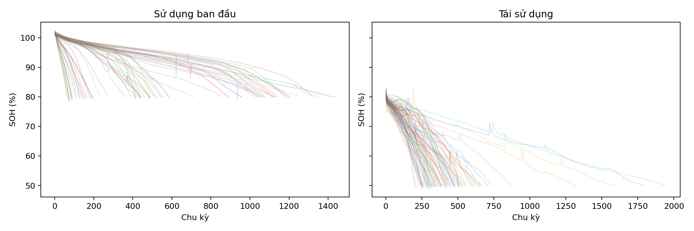
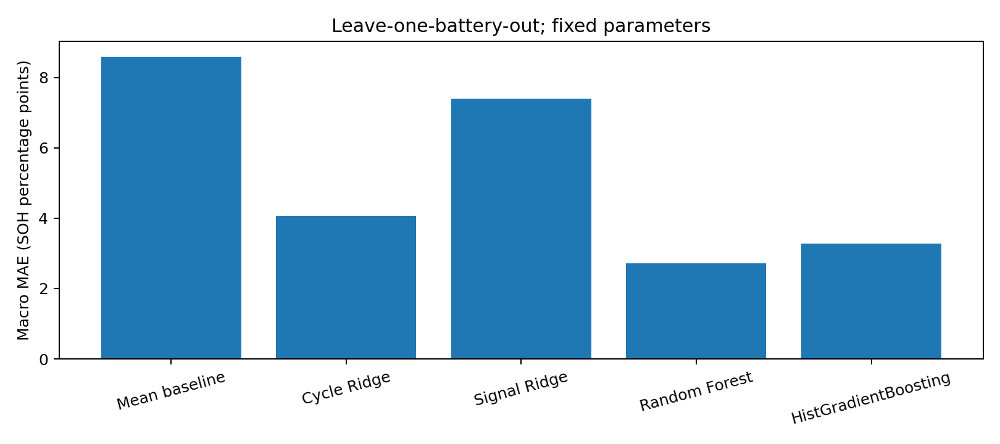
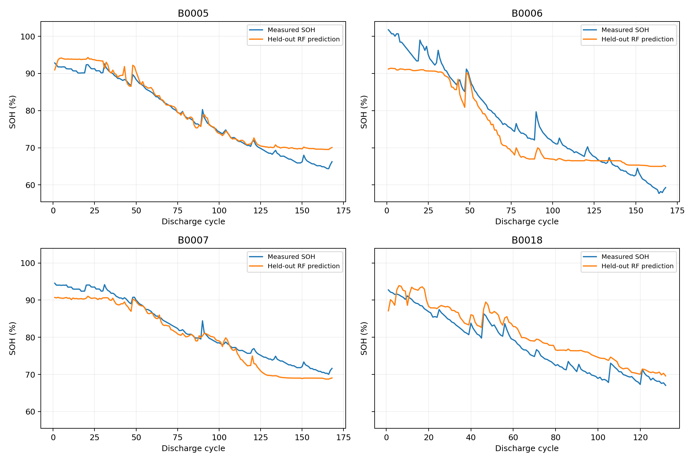
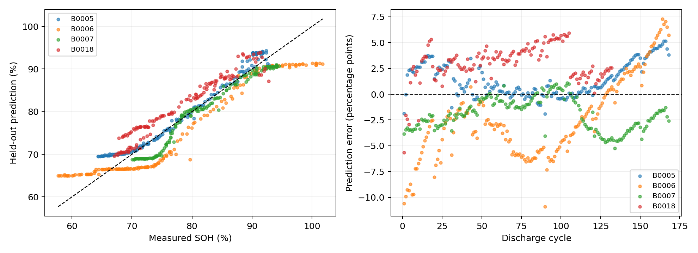
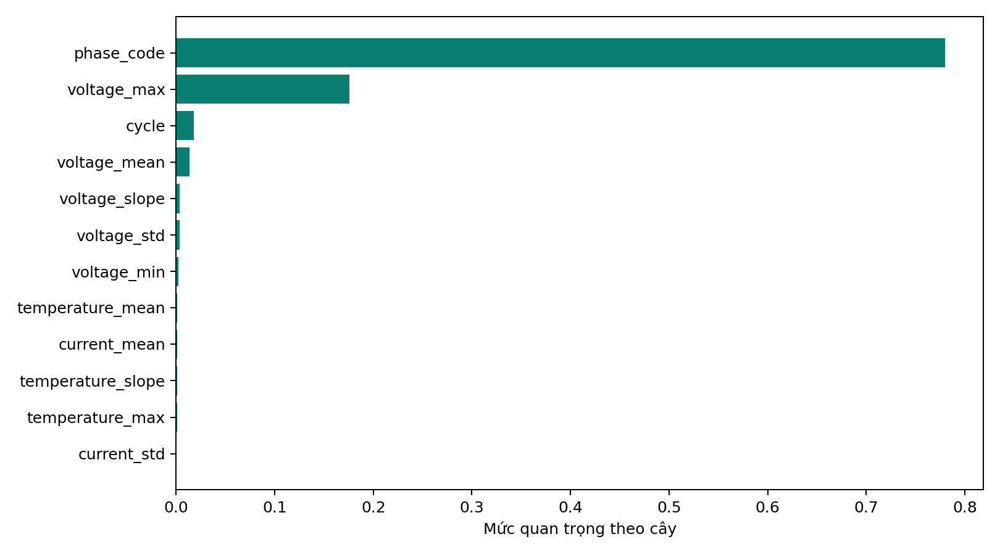

# TRƯỜNG ĐẠI HỌC NGUYỄN TẤT THÀNH
## KHOA CÔNG NGHỆ THÔNG TIN
# KHÓA LUẬN TỐT NGHIỆP
## PHÂN TÍCH VÀ DỰ ĐOÁN TÌNH TRẠNG SỨC KHỎE PIN XE ĐIỆN BẰNG CÁC MÔ HÌNH HỌC MÁY
Sinh viên: Nguyễn Văn Duy
Mã số sinh viên: 2311553949
Lớp: 23DTH2A
Chuyên ngành: Khoa Học Dữ Liệu
Giảng viên hướng dẫn: ThS. Vương Xuân Chí
TP. Hồ Chí Minh, năm 2026

# Tóm tắt
Tình trạng sức khỏe pin (State of Health — SOH) phản ánh dung lượng còn lại so với dung lượng danh định. Việc đo dung lượng đầy đủ cần cả một chu kỳ xả, trong khi ứng dụng theo dõi cần ước lượng từ một đoạn tín hiệu ngắn. Khóa luận xây dựng quy trình phân tích và ước lượng SOH từ 120 giây đầu chu kỳ xả bằng điện áp, dòng điện, nhiệt độ, số chu kỳ và giai đoạn sử dụng.
Tôi sử dụng dữ liệu SDU do Wang, Gao và Tian công bố trên Zenodo năm 2025 [1]. Tập nguồn có 145.112.317 dòng đo của 86 tế bào pin, gồm sử dụng ban đầu và tái sử dụng. Sau nhận diện điều kiện xả tham chiếu, bộ được chọn có 30.929.675 dòng và 20.823 chu kỳ. Bản dùng trong sản phẩm giữ 10.505.065 dòng, đủ 86 pin và đủ các chu kỳ đã chọn; mọi điểm trong cửa sổ đầu xả được giữ nguyên. Giảm mật độ sau 120 giây giúp giảm dung lượng lưu trữ, không được coi là loại bỏ nhiễu.
Bốn mô hình nghiên cứu gồm Ridge, Random Forest, LightGBM và GRU; mô hình dự đoán bằng trung bình SOH là mốc đối chứng. Kiểm thử 5 vòng chia theo mã pin vật lý, giữ hai giai đoạn của cùng pin ở cùng phía. Chỉ số chính lấy trung bình theo pin. Random Forest đạt MAE {{RF_MAE}}, RMSE {{RF_RMSE}} điểm phần trăm SOH và R² {{RF_R2}}. Kết quả này thuộc dữ liệu thí nghiệm đã chọn, chưa chứng minh hiệu quả trên bộ pin xe vận hành thực tế.
Sản phẩm Vincent D cung cấp tra cứu tín hiệu, so sánh chu kỳ, đánh giá mô hình, dự đoán một chu kỳ hoặc theo lô, lịch sử phiên và hồ sơ nguồn dữ liệu. Báo cáo, notebook, bảng thực nghiệm và mã xử lý được lưu cùng dự án để đối chiếu và tái lập.
Từ khóa: SOH, pin lithium-ion, trích xuất đặc trưng, học máy, GRU, SDU.

# Chương 1. Tổng quan đề tài
## 1.1. Vấn đề nghiên cứu
Pin lithium-ion suy giảm theo thời gian và quá trình sử dụng. Dung lượng có thể thay đổi theo điều kiện đo, nhiệt độ và chế độ dòng điện. SOH hỗ trợ mô tả mức suy giảm dung lượng nhưng không thể thay thế toàn bộ việc đánh giá an toàn hoặc công suất của pin. Một giá trị SOH đơn lẻ chưa đủ quyết định pin có phù hợp với một ứng dụng cụ thể hay không.
Đo dung lượng xả toàn chu kỳ là cách tạo tham chiếu trực tiếp, nhưng thời gian đo dài. Bài toán trong khóa luận là dùng tín hiệu đầu xả để ước lượng giá trị tham chiếu này. Dự đoán được thực hiện sau khi đã quan sát cửa sổ 120 giây; đây không phải dự báo trước khi bắt đầu chu kỳ.
## 1.2. Mục tiêu
Tôi xây dựng một quy trình có thể kiểm tra từ nguồn dữ liệu đến kết quả dự đoán. Các mục tiêu gồm: kiểm tra tính toàn vẹn và chất lượng dữ liệu; tạo nhãn SOH và đặc trưng không dùng thông tin cuối chu kỳ; so sánh các mô hình dưới cùng phân hoạch pin; phân tích sai số theo giai đoạn; triển khai ứng dụng tra cứu và ước lượng.
Khóa luận ưu tiên Python và các thư viện phổ biến. Mã nguồn chia thành xử lý dữ liệu, huấn luyện, đánh giá và giao diện. Cách chia này giúp thay đổi một thành phần mà vẫn kiểm tra được ảnh hưởng đến các thành phần còn lại.
## 1.3. Câu hỏi nghiên cứu
Câu hỏi thứ nhất là liệu tín hiệu 120 giây đầu xả có cung cấp thông tin hữu ích so với dự đoán một giá trị trung bình hay không. Câu hỏi thứ hai là mô hình phi tuyến có giảm sai số so với hồi quy tuyến tính điều chuẩn hay không. Câu hỏi thứ ba là sai số khác nhau thế nào giữa sử dụng ban đầu và tái sử dụng. Câu hỏi cuối là việc bỏ số chu kỳ, giai đoạn hoặc nhóm tín hiệu ảnh hưởng thế nào đến kết quả.
Các câu hỏi được trả lời bằng số liệu thực nghiệm và thiết kế kiểm thử đã nêu. Khóa luận không đặt trước yêu cầu R² phải đạt một ngưỡng cụ thể và không điều chỉnh kết quả để đạt ngưỡng.
## 1.4. Đối tượng và phạm vi
Đối tượng là 86 tế bào Lishen LR1865SZ, điện cực NMC(532)/graphite, dung lượng danh định 2,4 Ah. Hai giai đoạn dữ liệu thuộc cùng những pin này, không phải hai nhóm độc lập. Phạm vi thực nghiệm là các đoạn xả có điều kiện tham chiếu gần 0,2C được nhận diện từ tín hiệu nguồn.
Tên đề tài đề cập pin xe điện; dữ liệu thực nghiệm hiện tại ở cấp tế bào trong phòng thí nghiệm. Kết quả không được suy rộng trực tiếp đến bộ pin nhiều tế bào, hệ thống quản lý pin hoặc xe tại Việt Nam. SOC là mức sạc hiện tại, SOH là tình trạng sức khỏe tương đối; khóa luận không dự báo RUL là tuổi thọ còn lại.
## 1.5. Sản phẩm và đóng góp
Sản phẩm gồm bộ chọn có hồ sơ nguồn, bảng đặc trưng 20.823 mẫu, các mô hình và kết quả kiểm thử, notebook phân tích, ứng dụng Vincent D và tài liệu nghiên cứu. Đóng góp thực hành là quy trình giữ nguyên số đo nguồn, kiểm tra nhãn/đặc trưng và chia tập theo pin qua cả hai giai đoạn. Khóa luận không đề xuất một thuật toán học máy mới.

# Chương 2. Cơ sở lý thuyết và mô hình
## 2.1. SOH theo dung lượng
Nhãn được định nghĩa: SOH (%) = 100 × Q_xả / Q_danh_định, với Q_danh_định = 2,4 Ah. Q_xả lấy từ dung lượng tham chiếu toàn chu kỳ trước khi giảm mật độ điểm đo. Không tính lại nhãn bằng tích phân trên bản đã lấy thưa vì sai số lấy mẫu có thể làm lệch dung lượng.
Giá trị SOH trên 100% được giữ nguyên khi dung lượng đo lớn hơn danh định. Không cắt giá trị về 100% để làm đường cong đẹp hơn. Sự thay đổi SOH giữa các chu kỳ có thể gồm cả thay đổi dung lượng và ảnh hưởng điều kiện đo; không ép đường SOH phải giảm đơn điệu.
## 2.2. Dữ liệu đo và mẫu huấn luyện
Một dòng cảm biến chứa các số đo tại một thời điểm; một mẫu huấn luyện trong mô hình bảng đại diện cho một chu kỳ. Do đó, 10.505.065 dòng không tương đương 10.505.065 mẫu độc lập. Các điểm cùng chu kỳ có liên hệ theo thời gian, và các chu kỳ cùng pin cũng có liên hệ.
Mỗi mẫu có khóa gồm mã pin, giai đoạn và số chu kỳ. Số chu kỳ có thể bắt đầu lại khi chuyển giai đoạn; chỉ dùng mã pin và số chu kỳ sẽ làm lẫn hai quá trình. Mã pin dùng để phân nhóm kiểm thử, không dùng làm đầu vào mô hình.
## 2.3. Trích xuất đặc trưng
Từ tín hiệu trong 0–120 giây, chương trình giữ các mẫu đang xả và tính trung bình, cực trị, độ lệch chuẩn và độ dốc. Độ lệch chuẩn dùng định nghĩa tổng thể, cùng quy ước trong huấn luyện và dự đoán. Độ dốc là hệ số hồi quy tuyến tính theo thời gian đã trừ trung bình, không lấy hiệu giữa hai mẫu tùy ý.
Bảng đầu vào có 12 cột: giai đoạn, số chu kỳ, năm đặc trưng điện áp, hai đặc trưng dòng điện và ba đặc trưng nhiệt độ. Thông tin toàn chu kỳ như dung lượng, SOH, tổng số điểm, điện áp cuối và thời lượng xả không được đưa vào danh sách đầu vào.
## 2.4. Mốc trung bình và Ridge
Mốc trung bình dự đoán trung bình SOH của tập huấn luyện cho mọi mẫu kiểm thử. Đây là phép kiểm tra xem mô hình có học được thông tin tốt hơn một dự đoán hằng số hay không.
Ridge là hồi quy tuyến tính với phạt L2 lên hệ số [3]. Chuẩn hóa giúp các biến có đơn vị khác nhau đóng góp vào quá trình tối ưu ở thang đo hợp lý. Bộ chuẩn hóa chỉ được học từ tập huấn luyện trong từng vòng. Ridge dễ giải thích và tính toán nhanh, nhưng khó mô tả quan hệ phi tuyến nếu chỉ dùng các biến gốc.
## 2.5. Random Forest
Random Forest kết hợp nhiều cây quyết định được huấn luyện có ngẫu nhiên [4]. Mô hình phù hợp dữ liệu bảng và có thể biểu diễn tương tác phi tuyến giữa số chu kỳ, điện áp và nhiệt độ mà không yêu cầu chuẩn hóa các biến.
Cấu hình sử dụng 100 cây, độ sâu tối đa 16, tối thiểu 5 mẫu ở lá và tỷ lệ mẫu mỗi cây 0,7. Giới hạn độ sâu và kích thước lá giúp hạn chế học quá sát các mẫu. Chỉ số quan trọng đặc trưng từ cây chỉ mô tả cách mô hình sử dụng biến, không chứng minh quan hệ nhân quả. Các biến tương quan có thể chia sẻ hoặc thay thế mức quan trọng.
## 2.6. LightGBM
LightGBM là phương pháp tăng cường cây dùng cách biểu diễn histogram để tăng hiệu quả tính toán [5]. Các cây học lần lượt nhằm giảm phần sai số còn lại. Cấu hình trong khóa luận cố định 150 cây, tối đa 15 lá, tốc độ học 0,05 và phạt L2 bằng 1.
LightGBM phù hợp quan hệ phi tuyến và dữ liệu bảng. Kết quả phụ thuộc cấu hình và dữ liệu; việc một cấu hình có sai số cao hơn Random Forest không chứng minh mọi cấu hình LightGBM đều kém hơn. Khóa luận không tối ưu siêu tham số trên các pin kiểm thử.
## 2.7. GRU
GRU là mạng hồi tiếp có cổng, dùng để biểu diễn thông tin theo thứ tự trong chuỗi [6]. Đầu vào chuỗi của nghiên cứu là điện áp, dòng điện và nhiệt độ ở 25 vị trí đều nhau trong 120 giây. Các vị trí được nội suy tuyến tính từ bản sao tín hiệu; ở biên dùng giá trị đầu/cuối gần nhất. Đây là biểu diễn dẫn xuất cho mô hình, không ghi đè hoặc sửa CSV nguồn.
GRU có 24 đơn vị ẩn. Trạng thái cuối được ghép với số chu kỳ và giai đoạn rồi đi qua lớp kết nối để dự đoán SOH. Huấn luyện 20 epoch, batch 256, Adam với tốc độ học 0,002. Tín hiệu, biến ngữ cảnh và nhãn được chuẩn hóa theo tập huấn luyện của từng vòng. Chuỗi của một mẫu không nối qua chu kỳ khác hoặc qua pin khác.
GRU giữ thông tin diễn biến mà các thống kê tổng hợp có thể bỏ qua, nhưng cần nhiều phép tính và khó giải thích hơn. Vì biểu diễn đầu vào khác mô hình bảng, phép so sánh đo hiệu quả của cả cách biểu diễn và mô hình, không tách riêng ảnh hưởng của thuật toán. Khóa luận chưa khảo sát đầy đủ cửa sổ khác, kiến trúc khác hoặc độ nhạy theo nhiều seed.
## 2.8. Chỉ số đánh giá
MAE là trung bình độ lớn sai số, cùng đơn vị với SOH được biểu diễn bằng phần trăm. RMSE là căn trung bình bình phương sai số, nhạy hơn với sai số lớn. R² so sánh sai số bình phương của mô hình với dự đoán trung bình trong tập được đánh giá; R² có thể âm.
Nếu SOH thực tế là 90% và dự đoán là 92%, sai số là 2 điểm phần trăm SOH. MAE bằng 2 không có nghĩa mô hình có độ chính xác 98%. Chỉ số chính được tính riêng trên từng pin giữ riêng, sau đó lấy trung bình không trọng số giữa 86 pin, tránh để pin có nhiều chu kỳ chi phối toàn bộ kết quả.

# Chương 3. Dữ liệu và phương pháp thực hiện
## 3.1. Nguồn và giấy phép
Nguồn dữ liệu: Wang, S., Gao, F. và Tian, H. (2025), Data for: Deep sorting of reused batteries for enabling long-term consistency grouping with unknown prior conditions [1]. DOI: 10.5281/zenodo.14859405, giấy phép CC BY 4.0. Bài báo liên quan có DOI 10.1016/j.xcrp.2025.102657 [2]. Ngày công bố 12/02/2025 không đồng nghĩa mọi phép đo đều được thực hiện trong năm 2025.
Hai gói gốc là Primary_use_phase.zip và Second_life_phase.zip. Kích thước lần lượt 2.694.002.794 byte và 1.794.732.202 byte. MD5 công bố lần lượt là 15d94a62d47dd9036899889b3f36992d và 0ba11864d2c1017c84d96dfe578956fc. Cả hai đã được đối chiếu sau tải. Tổng 172 CSV tương ứng 86 pin qua hai giai đoạn.
Tên file không được dùng thay mã pin. Cột Battery_ID của nguồn được ánh xạ thành SDU_01 đến SDU_86 trong bảng xử lý. Ví dụ file mang số hiệu khác mã pin vẫn phải được gán theo Battery_ID. Việc thiếu một số số hiệu tên file không có nghĩa thiếu các pin có cùng số đó.
## 3.2. Điều kiện chọn đoạn xả
Từ 145.112.317 dòng nguồn, quy trình nhận diện các đoạn xả gần dòng tham chiếu −0,48 A. Trung vị dòng phải nằm trong khoảng tham chiếu với dung sai 0,03 A và ít nhất 95% mẫu nằm trong dải đó. Điện áp đầu ít nhất 4 V; điện áp cuối từ 2,95 đến 3,05 V. Các tín hiệu thời gian, điện áp, dòng điện và nhiệt độ phải hữu hạn, khóa thời gian không trùng trong chu kỳ.
Các kiểm tra dung lượng gồm dung lượng đầu không vượt 0,01 Ah, không giảm quá dung sai 0,0001 Ah và giới hạn dung lượng theo 1,2 lần danh định. Dung lượng ghi nhận được đối chiếu tích phân dòng điện với sai số cho phép lớn hơn giữa 0,02 Ah và 2%. Cửa sổ đầu xả cần ít nhất 5 điểm và độ phủ đến ít nhất 90 giây.
Kết quả chọn là 30.929.675 dòng của 20.823 chu kỳ. Không gọi mọi đoạn này là chu kỳ chẩn đoán do tác giả gán nhãn; tiêu chí đang nhận diện điều kiện từ tín hiệu. Chọn điều kiện tương đồng giúp giảm khác biệt chế độ đo, đồng thời thu hẹp phạm vi áp dụng của mô hình.
## 3.3. Tạo bản 10.505.065 dòng
Bản gọn giữ tất cả các chu kỳ đã chọn, mọi mẫu trong 120 giây đầu và điểm cuối mỗi chu kỳ. Sau khi giữ các điểm bắt buộc, phần còn lại trong từng chu kỳ được sắp theo thời gian và giữ một trong ba điểm liên tiếp, bắt đầu từ điểm đầu của phần này. Không đặt trước tổng số dòng. Từng dòng được giữ nguyên văn từ nguồn, không nhân bản, điền thiếu hay sửa số đo.
Sau giảm mật độ, nguồn lưu 10.505.065 dòng trong 172 file CSV nén gzip. Dung lượng tham chiếu, nhãn và bảng đặc trưng được giữ từ bộ đủ điểm và được đối chiếu lại. Phần sau 120 giây mất chi tiết, nên bản này không thay thế dữ liệu đầy đủ cho nghiên cứu cần phân tích nguyên chuỗi hoặc tính ICA chính xác ở toàn bộ miền điện áp.
Số 10.505.065 là kết quả đếm sau khi áp dụng quy tắc lấy thưa, không phải số dòng được đặt trước. Đây không phải ngưỡng đảm bảo chất lượng học máy. Số pin độc lập và số chu kỳ hữu ích mới là thông tin cần báo cáo cùng số điểm cảm biến.
## 3.4. Kiểm tra chất lượng
Bản xử lý được quét toàn bộ 10.505.065 dòng. Không phát hiện giá trị thiếu/vô hạn ở tín hiệu bắt buộc hoặc khóa thời gian trùng. Nội dung dòng giải nén được kiểm SHA-256 theo file, đặc trưng được tính lại và nhãn được nối theo khóa pin/giai đoạn/chu kỳ.
Có 26 điểm nghi vấn biến thiên đột ngột còn nằm trong bộ chọn, không điểm nào thuộc 120 giây đầu. Đây là cờ kiểm tra theo quy tắc, chưa phải xác nhận lỗi cảm biến; các điểm không bị tự xóa hoặc sửa. Có 23 bước thời gian đi lùi trong thứ tự ghi nguồn. Bản sao phục vụ xử lý được sắp theo thời gian trong từng chu kỳ, còn file nguồn giữ nguyên.
Không có lỗi được phát hiện theo các kiểm tra trên không có nghĩa dữ liệu hoàn toàn không có nhiễu hoặc không có sai lệch đo. Những giới hạn kiểm tra và danh sách điểm nghi vấn được phát kèm để có thể xem xét lại.
## 3.5. Tạo bảng đặc trưng
Thời gian đầu xả của mỗi chu kỳ được quy về 0 trên bản xử lý. Cửa sổ lấy mẫu từ 0 đến 120 giây, ít nhất 5 điểm, thời gian bắt đầu không quá 20 giây và điểm cuối ít nhất 90 giây. Phần đang xả cần ít nhất 3 mẫu có dòng dưới −0,1 A và trải ít nhất 30 giây. Các thống kê được tính trên phần xả trong cửa sổ.
{{FEATURE_TABLE}}
Các cột capacity_ah, soh_pct, integrated_capacity_ah, measurement_rows, start_voltage_v và end_voltage_v có thể tồn tại trong bảng kiểm tra, nhưng chỉ đúng 12 cột FEATURES được đưa vào mô hình bảng. Đây là ranh giới quan trọng để tránh dùng biến liên quan trực tiếp đến nhãn.
## 3.6. Phân hoạch và phòng tránh rò rỉ
Chương trình dùng GroupKFold với 5 nhóm, trộn nhóm và seed 42. Đơn vị nhóm là mã pin vật lý. Khi một pin thuộc kiểm thử, mọi chu kỳ ở cả hai giai đoạn của pin đó đều không nằm trong huấn luyện của vòng tương ứng. Mỗi pin xuất hiện ở đúng một vòng kiểm thử.
Không chia ngẫu nhiên các dòng cảm biến vì các điểm rất gần nhau trong cùng chu kỳ sẽ làm kết quả quá lạc quan. Không dùng mã pin làm đặc trưng. Các bộ chuẩn hóa của Ridge và GRU chỉ học từ tập huấn luyện. Tham số mô hình được cố định; không lựa chọn cấu hình bằng điểm kiểm thử.
Thiết kế vẫn có giới hạn: các pin đến từ cùng một chiến dịch thí nghiệm và cùng loại hóa học, nên giữ riêng pin chưa tương đương giữ riêng phòng thí nghiệm, nhà sản xuất hay môi trường vận hành.
## 3.7. Các kiểm tra bổ sung
Thí nghiệm bỏ đặc trưng dùng Random Forest và cùng phân hoạch pin. Ba biến thể là bỏ số chu kỳ, bỏ giai đoạn và chỉ dùng điện áp; đối chiếu cấu hình đủ đặc trưng. Chênh lệch được mô tả theo sai số, chưa được kiểm định ý nghĩa thống kê.
Kiểm thử thời gian sắp thứ tự trong từng pin và giai đoạn, dùng 70% mẫu đầu để học và 30% cuối để kiểm thử. Mô hình học trên phần quá khứ gộp của các pin; đối chứng là giữ nguyên SOH cuối đã biết của từng pin/giai đoạn. Đây là nghiên cứu tiếp diễn trên pin đã có lịch sử, không phải kiểm thử pin mới và chưa phải mô phỏng triển khai đồng bộ theo lịch tuyệt đối giữa mọi pin.
## 3.8. Môi trường và khả năng tái lập
Ngôn ngữ Python 3.12; pandas và NumPy xử lý bảng, PyArrow lưu Parquet, scikit-learn huấn luyện và đánh giá, LightGBM tăng cường cây, PyTorch triển khai GRU, Matplotlib và Altair biểu diễn kết quả, Streamlit triển khai giao diện. Phiên bản thực tế và cấu hình được lưu trong run_metadata.json và gru_metadata.json.
Dữ liệu thô được đọc lần lượt theo pin/giai đoạn. Bản ứng dụng dùng Parquet, đọc theo chu kỳ cần xem thay vì nạp toàn bộ. Huấn luyện mô hình bảng chỉ cần 20.823 mẫu × 12 đặc trưng; GRU dùng chuỗi 25 × 3. Số luồng CPU giới hạn ở 2. Thiết kế giảm nhu cầu RAM nhưng không đảm bảo không chậm nếu máy đang chạy nhiều chương trình khác.

# Chương 4. Kết quả và thảo luận
## 4.1. Quy mô bộ dữ liệu
Tập dùng trong sản phẩm có 10.505.065 dòng đo, 20.823 mẫu chu kỳ của 86 pin, gồm cả sử dụng ban đầu và tái sử dụng. Bảng dưới tổng hợp theo giai đoạn từ dữ liệu thực tế, không suy ra số chu kỳ bằng số dòng cảm biến.
{{PHASE_TABLE}}

Hai giai đoạn được vẽ riêng vì số chu kỳ có thể bắt đầu lại. Đường cong của một pin không được nối trực tiếp qua điểm chuyển giai đoạn nếu chưa có thang thời gian thống nhất.
## 4.2. Kết quả kiểm thử pin giữ riêng
{{SUMMARY_TABLE}}
Chỉ số trong bảng là trung bình theo 86 pin. Mốc trung bình cho biết mức sai số khi bỏ qua tín hiệu. Ridge thể hiện quan hệ tuyến tính có điều chuẩn. Random Forest và LightGBM biểu diễn phi tuyến trên cùng bảng 12 đặc trưng. GRU dùng biểu diễn chuỗi đầu xả cùng ngữ cảnh.
{{RESULT_DISCUSSION}}

Đây là kết quả của các cấu hình đã cố định. Chưa có tìm kiếm siêu tham số lồng trong phân hoạch pin hoặc khảo sát nhiều seed, nên không kết luận một thuật toán luôn tốt nhất trên mọi bộ dữ liệu pin.
## 4.3. Kết quả theo giai đoạn
{{PHASE_METRICS_TABLE}}
Bảng theo giai đoạn tính gộp các mẫu trong mỗi giai đoạn, khác cách lấy trung bình theo pin ở bảng chính. Do trọng số mẫu khác nhau, các con số không cần trùng với trung bình đơn giản của bảng chính. Chỉ số theo giai đoạn giúp nhận diện nơi mô hình cần cải thiện, nhưng không tự giải thích nguyên nhân vật lý.
## 4.4. Phân tích dự đoán và sai số

Sai số dương thể hiện mô hình đánh giá sức khỏe cao hơn tham chiếu; sai số âm thể hiện đánh giá thấp hơn. Việc xem phân bố và các pin sai số cao bổ sung thông tin mà MAE tổng hợp có thể che khuất. Các dự đoán trong hình đến từ pin giữ riêng trong từng vòng, không lấy từ mô hình học lại toàn bộ dữ liệu dùng cho ứng dụng.
{{ERROR_DISCUSSION}}
## 4.5. Bỏ nhóm đặc trưng
{{ABLATION_TABLE}}
{{ABLATION_DISCUSSION}}
Việc bỏ một nhóm biến làm thay đổi khả năng mô hình sử dụng cả những biến tương quan còn lại. Vì vậy chênh lệch sai số không tương đương tác động nhân quả của đại lượng vật lý. Kết quả chỉ được dùng để đánh giá tính hữu ích trong cấu hình đã thử.

## 4.6. Kiểm thử theo thời gian
{{TEMPORAL_TABLE}}
{{TEMPORAL_DISCUSSION}}
Mô hình cây thường khó ngoại suy khi các đặc trưng hoặc vùng SOH trong tương lai vượt miền dữ liệu học. Đối chứng SOH cuối đã biết là một cách kiểm tra thực tế hơn mốc trung bình trong thiết kế này. Không gộp kết quả 70/30 với GroupKFold để tạo một chỉ số duy nhất.
## 4.7. Thời gian thực nghiệm
{{TIMING_TABLE}}
Thời gian là số đo trên môi trường chạy thực nghiệm, không phải cam kết thời gian trên máy khác. Với GRU, cột thời gian học bao gồm chuẩn hóa, huấn luyện và suy luận trong vòng; chưa đo suy luận riêng. Không so sánh trực tiếp hai cột này như một phép đo hiệu năng chuẩn hóa giữa các thư viện. Huấn luyện và dự đoán giao diện là hai hoạt động riêng, ứng dụng không tự huấn luyện lại khi đổi trang.
## 4.8. Giới hạn kết luận
Kết quả phản ánh bộ chọn xả tham chiếu cùng loại pin. Chưa có kiểm thử độc lập với dữ liệu Việt Nam, hóa học khác, nhà sản xuất khác, chế độ xả động hoặc pin ở cấp pack. Thông tin số chu kỳ và giai đoạn được giả định biết tại thời điểm ước lượng; không kết luận mô hình dùng được nếu thiếu các thông tin này.
Số chu kỳ nhiều không loại bỏ giới hạn chỉ có 86 pin. Sai số trung bình không cung cấp khoảng tin cậy cho một dự đoán đơn. Chưa có hiệu chỉnh độ bất định, đánh giá nhiều seed hoặc kiểm định thống kê chênh lệch mô hình. Những nội dung này là hướng phát triển, không được báo cáo như kết quả đã hoàn thành.

## 4.9. Giám sát xu hướng SOH bất thường
Phần bổ sung giám sát SOH tham chiếu đã quan sát theo từng pin và giai đoạn. Nền dự kiến dùng tốc độ biến thiên trung vị của tối đa 8 khoảng quá khứ, ít nhất 5 khoảng. Tốc độ tính theo chênh lệch số chu kỳ thực, không coi các mẫu xả tham chiếu là những chu kỳ liên tiếp. Độ lệch chuẩn hóa dùng MAD quá khứ với sàn thang đo 0,01 điểm phần trăm SOH mỗi chu kỳ. Quy tắc gắn cờ yêu cầu độ lệch chuẩn hóa trên 4,5 và sai lệch tuyệt đối ít nhất 1 điểm phần trăm SOH.
Isolation Forest [8] dùng 150 cây, max_samples 256 và seed 42. Đặc trưng là tốc độ hiện tại, tốc độ nền quá khứ, sai lệch SOH và độ lệch chuẩn hóa. Cùng phân hoạch 5 vòng theo pin; ngưỡng là phân vị 99% điểm các pin học của từng vòng. Không chọn ngưỡng bằng tập kiểm thử. Dữ liệu học chưa có nhãn lỗi, nên cách làm giả định đa số diễn biến là thông thường, không chứng minh tập học hoàn toàn bình thường.
Kết hợp hai phương pháp theo phép hoặc cho 74 cờ trong 12.145 mẫu đủ lịch sử giai đoạn đầu và 135 cờ trong 7.646 mẫu đủ lịch sử tái sử dụng, tương ứng khoảng 0,61% và 1,77%. Cờ chu kỳ SOH khác các điểm nghi vấn tín hiệu điện áp/nhiệt độ ở phần kiểm tra dữ liệu, không cộng chung hai số đếm. Số cờ không phải số lỗi xác nhận hoặc độ chính xác. Chưa có nhãn lỗi nên không báo cáo precision, recall hay mức cải thiện phát hiện lỗi thực tế. Các điểm không bị tự sửa hoặc xóa.
Thiết kế dùng các quan sát SOH quá khứ của chính pin đang giám sát, nhưng không dùng tương lai để tạo nền. SOH tham chiếu cần phép đo dung lượng; kết quả không đồng nghĩa cảnh báo BMS trực tuyến hoặc chứng nhận pin nguy hiểm. Chưa có dữ liệu BMS trên xe, nên chưa thực hiện kiểm chứng thực tế. Kế hoạch và dữ liệu cần có được ghi riêng trong docs/kiem-chung-bms.md.

## 4.10. Phương án khóa luận: Ridge–RF hiệu chỉnh phần dư
Tôi kiểm chứng cách kết hợp hai thuật toán có sẵn [3,4]: Ridge học xu hướng nền; Random Forest học phần dư r_train = y_train − Ridge(X_train). Kết quả cuối là SOH_dự_đoán = Ridge(X) + RF_phần_dư(X). Chỉ tập train được dùng để học bộ chuẩn hóa, hệ số Ridge và cây phần dư. Không dùng nhãn pin kiểm thử để hiệu chỉnh. Bảng đầu vào giữ đúng 12 đặc trưng, cùng 5 nhóm pin và seed 42; cấu hình được cố định, không tối ưu theo các điểm test.
{{HYBRID_TABLE}}
Phương án phần dư đạt MAE khoảng 1,612 điểm phần trăm SOH so với 1,619 của RF; RMSE khoảng 2,160 so với 2,157. Cải thiện MAE nhỏ và RMSE hơi tăng, chưa chứng minh ưu thế rõ ràng. Kết quả theo từng pin, cả trường hợp tăng và giảm sai số, được giữ trong reports/hybrid_paired_comparison.csv. Chưa khảo sát nhiều seed hoặc bộ dữ liệu độc lập nên không khẳng định cải tiến có ý nghĩa thống kê hoặc tổng quát.
Đây là phương án kết hợp được triển khai và đánh giá trong khóa luận, không tuyên bố là thuật toán hoàn toàn mới hoặc công bố đầu tiên. Mô hình học lại toàn bộ được lưu riêng và có thể chọn trên trang dự đoán; kết quả này tách khỏi các dự đoán giữ riêng dùng đánh giá. Random Forest vẫn là lựa chọn mặc định của ứng dụng, không dùng chênh lệch nhỏ trên test để tuyên bố đổi mô hình tốt nhất.

# Chương 5. Xây dựng sản phẩm Vincent D
## 5.1. Kiến trúc phần mềm
Quy trình gồm tầng nguồn CSV gzip, tầng chuyển đổi Parquet, tầng đặc trưng và huấn luyện, tầng báo cáo kết quả và tầng giao diện. Thư mục src/battery_soh chứa hàm đặc trưng dùng chung; scripts chứa các bước có thể chạy lại; app/screens chia từng màn hình; reports lưu bằng chứng thực nghiệm; artifacts lưu mô hình tin cậy do dự án tạo.
Giao diện đọc bảng nhỏ cho thống kê và chỉ đọc dữ liệu chu kỳ khi cần. Mô hình được nạp một lần trong bộ nhớ đệm. Trình duyệt nhận dữ liệu biểu đồ đã giới hạn điểm hiển thị, trong khi file xuất vẫn giữ các mẫu theo bộ lọc. Cách này tránh gửi hàng triệu điểm lên trình duyệt.
## 5.2. Các chức năng
Tổng quan trình bày quy mô dữ liệu, sai số và đường SOH theo giai đoạn. Tra cứu cho phép lọc pin, giai đoạn, khoảng chu kỳ, xem tín hiệu và so sánh hai chu kỳ. Đánh giá mô hình hiển thị chỉ số, dự đoán giữ riêng, sai số, thời gian và thử nghiệm bỏ đặc trưng.
Dự đoán nhận CSV hoặc CSV.GZ tới 512 MiB cho một chu kỳ hoặc tối đa 2.000 nhóm trong một lần. Chương trình kiểm tra tên cột, tín hiệu hữu hạn, số chu kỳ và giai đoạn. Với lô dữ liệu, lỗi của một nhóm được báo riêng, không làm mất các kết quả hợp lệ khác. CSV mẫu có nhãn nguồn và không được trình bày như kiểm thử độc lập.
Lịch sử chỉ lưu trong phiên làm việc, không phải cơ sở dữ liệu người dùng. Phiếu kết quả có thể tải dưới dạng CSV và HTML. Trang Xu hướng bất thường hiển thị chuỗi SOH, nền quá khứ, cờ của quy tắc/Isolation Forest và lý do; dữ liệu có thể xuất CSV. Trang chất lượng trình bày nguồn, tiến trình chọn dữ liệu và các điểm nghi vấn. Trang thông tin cung cấp trích dẫn và tài liệu nghiên cứu.
## 5.3. Mô hình ứng dụng
Random Forest là mô hình triển khai được quy định trước cho bản ứng dụng. Mô hình này được học lại trên toàn bộ 20.823 mẫu để phục vụ ước lượng; không lấy sai số trên chính dữ liệu học lại để báo cáo chất lượng. Điểm thực nghiệm luôn đọc từ các dự đoán giữ riêng đã lưu.
Ứng dụng hiển thị cảnh báo khi đặc trưng nằm ngoài khoảng quan sát của dữ liệu huấn luyện. Kiểm tra khoảng riêng từng biến chưa đủ phát hiện mọi trường hợp ngoài phân phối. Dự đoán không bị ép vào một khoảng đẹp hơn và không được dùng như chứng nhận an toàn pin.
## 5.4. Kiểm tra sản phẩm
Các kiểm thử bao gồm tính độc lập của đặc trưng với tín hiệu sau 120 giây và nhãn, tính đúng định nghĩa SOH, khóa pin/giai đoạn/chu kỳ, phân hoạch không trùng pin, đối chiếu chỉ số với dự đoán đã lưu và kiểm thử các màn hình Streamlit. Dự đoán mẫu, dự đoán theo lô, lịch sử phiên và lỗi CSV cũng được kiểm tra.
{{TEST_DISCUSSION}}
## 5.5. Lưu trữ và bàn giao
Gói sản phẩm chứa mã nguồn, thư viện được khóa phiên bản, dữ liệu Parquet phục vụ tra cứu, bảng đặc trưng, mô hình, notebook đã chạy, kết quả thực nghiệm và báo cáo/slide. Bộ dữ liệu nguồn được nộp riêng dưới dạng source_rows với hai giai đoạn, các bảng chu kỳ và hồ sơ kiểm tra, trích dẫn. Không cần giải nén từng file CSV gzip để chương trình đọc.
Các file nguồn lớn không được đưa vào bộ nhớ cùng lúc. Môi trường .venv không đóng gói vì phụ thuộc hệ điều hành; môi trường được tạo lại bằng danh sách thư viện. Dữ liệu nguồn không thuộc quyền sở hữu riêng của tác giả khóa luận và được sử dụng theo giấy phép CC BY 4.0.

# Kết luận
Khóa luận xây dựng quy trình phân tích và ước lượng SOH từ cửa sổ đầu xả, so sánh bốn mô hình và triển khai ứng dụng tra cứu. Dữ liệu và kết quả có nguồn đối chiếu; đơn vị kiểm thử là pin vật lý thay vì điểm đo riêng lẻ. Quy trình giữ nguyên số đo nguồn, công khai việc lấy thưa và các điểm nghi vấn.
Random Forest trong cấu hình đã chạy đạt MAE {{RF_MAE}} điểm phần trăm SOH trên kiểm thử pin giữ riêng. Các phép kiểm tra bổ sung cho thấy kết quả phụ thuộc biểu diễn đầu vào và thiết kế kiểm thử. Đây là bằng chứng trong phạm vi thí nghiệm SDU, chưa phải khẳng định hiệu quả trên xe thực tế.
Hướng phát triển gồm dữ liệu vận hành độc lập, mở rộng điều kiện dòng và nhiệt độ, tối ưu siêu tham số trong kiểm thử lồng, khảo sát nhiều seed, ước lượng độ bất định và đánh giá ở cấp bộ pin. Những nội dung này cần dữ liệu và thực nghiệm mới.

# Tài liệu tham khảo
[1] Wang, S., Gao, F., & Tian, H. (2025). Data for: Deep sorting of reused batteries for enabling long-term consistency grouping with unknown prior conditions [Data set]. Zenodo. https://doi.org/10.5281/zenodo.14859405. CC BY 4.0.
[2] Deep sorting of reused batteries for enabling long-term consistency grouping with unknown prior conditions. Cell Reports Physical Science (2025). https://doi.org/10.1016/j.xcrp.2025.102657.
[3] Hoerl, A. E., & Kennard, R. W. (1970). Ridge Regression: Biased Estimation for Nonorthogonal Problems. Technometrics, 12(1), 55–67. https://doi.org/10.1080/00401706.1970.10488634.
[4] Breiman, L. (2001). Random Forests. Machine Learning, 45, 5–32. https://doi.org/10.1023/A:1010933404324.
[5] Ke, G., et al. (2017). LightGBM: A Highly Efficient Gradient Boosting Decision Tree. Advances in Neural Information Processing Systems, 30. https://proceedings.neurips.cc/paper/2017/hash/6449f44a102fde848669bdd9eb6b76fa-Abstract.html.
[6] Cho, K., et al. (2014). Learning Phrase Representations using RNN Encoder–Decoder for Statistical Machine Translation. EMNLP. https://arxiv.org/abs/1406.1078.
[7] Pedregosa, F., et al. (2011). Scikit-learn: Machine Learning in Python. Journal of Machine Learning Research, 12, 2825–2830. https://jmlr.org/papers/v12/pedregosa11a.html.
[8] Liu, F. T., Ting, K. M., & Zhou, Z.-H. (2008). Isolation Forest. IEEE ICDM, 413–422. https://doi.org/10.1109/ICDM.2008.17.

# Phụ lục A. Kết quả Random Forest theo pin
Bảng lấy từ dự đoán kiểm thử pin giữ riêng. Chi tiết mọi mô hình được lưu trong reports/metrics_by_battery.csv và reports/predictions.csv.
{{BY_BATTERY_TABLE}}

# Phụ lục B. Cấu trúc mã nguồn
{{CODE_TABLE}}
Các hàm đặc trưng được dùng chung cho huấn luyện và giao diện, tránh hai cách tính khác nhau. Các file CSV đầu ra chứa tên cột gốc để chương trình đọc lại; giao diện dịch bản sao sang tiếng Việt.

# Phụ lục C. Cấu hình thực nghiệm
{{PARAMETER_TABLE}}
GRU: 3 tín hiệu × 25 vị trí; 24 đơn vị ẩn; 2 biến ngữ cảnh; lớp kết nối 24 nút; 20 epoch; batch 256; Adam 0,002; clip chuẩn gradient bằng 1. Seed 42. Không chọn epoch bằng tập kiểm thử.
Tham số, phiên bản và dấu vân tay bảng đặc trưng có tại reports/run_metadata.json và reports/gru_metadata.json. Các file chứa đầy đủ dự đoán được giữ để tính lại chỉ số, thay vì chỉ giữ ảnh biểu đồ.
