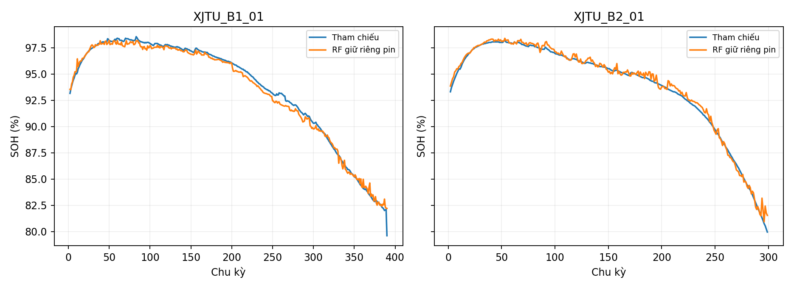

# Thực nghiệm bổ sung trên XJTU

## Nguồn và phạm vi

Wang, F. (2024). XJTU Battery Dataset. Zenodo, DOI 10.5281/zenodo.10963339, CC BY 4.0. Bài báo: Wang, F., Zhai, Z., Zhao, Z. et al. Nature Communications 15, 4332 (2024), DOI 10.1038/s41467-024-48779-z.

Pin Lishen 18650 NCM, danh định 2 Ah. Dữ liệu phòng thí nghiệm, không phải BMS đo trên xe. SDU 2,4 Ah tiếp tục là dữ liệu chính; không cộng số dòng hai nguồn để mô tả một bộ dữ liệu đồng nhất.

Chọn 23 pin thuộc Batch-1/2 trong 55 pin XJTU. Đã tải và kiểm tra CRC/SHA-256 của 23 thành viên MAT nguyên gốc từ ZIP tác giả. Tổng 46.215.511 điểm đo. 6.961 phần tử chu kỳ; 6.961 chu kỳ đạt kiểm tra đầu vào. 0 chu kỳ bị loại. 59 phép đo trùng giây được gộp trung bình trong cửa sổ dẫn xuất.

Batch-1/2 được chọn trước khi đánh giá vì quy trình cố định. Chu kỳ đầu là phép đo 0,2C; không dùng 23 chu kỳ đầu này trong đánh giá 1C chính. Bảng đặc trưng vẫn lưu các chu kỳ hợp lệ để đối chiếu. Số mẫu đánh giá chính: **6,938** chu kỳ. Không gọi dung lượng đo ở 1C và 0,2C là hoàn toàn tương đương; tải xả có thể ảnh hưởng dung lượng khả dụng.

## Đặc trưng, nhãn và phân hoạch

Cửa sổ 120 giây đầu đoạn xả; dùng system_time vì relative_time_min có thể đặt lại theo bước. Gom trung bình V/I/T cùng giây ở bản dẫn xuất, giữ nguyên MAT nguồn. SOH = summary.discharge_capacity_Ah / 2 Ah × 100; đối chiếu dung lượng cực đại đoạn xả, sai lệch tối đa cho phép 0,005 Ah. Không cắt SOH trên 100% và không lấy dung lượng đo làm đầu vào.

Mô hình bảng dùng 11 đặc trưng chung: bỏ phase_code, chia current_mean/current_std cho dung lượng danh định mỗi nguồn để đổi sang C-rate. Không dùng dung lượng đo thực tế để chuẩn hóa đặc trưng. GRU dùng 25 vị trí V/I/T trong 120 giây, dòng điện chia 2 Ah, cùng các nhóm pin; chuẩn hóa chỉ học trên train.

GroupKFold 5 vòng theo 23 pin vật lý, shuffle=True, seed=42. Tham số cố định, không tối ưu theo nhãn kiểm thử. Báo cáo trung bình không trọng số theo pin. Mô hình ứng dụng refit sau đánh giá; kết quả refit trên chính pin đã học không được tính như kiểm thử độc lập.

## So sánh mô hình trên pin XJTU giữ riêng

| model | mae | rmse | r2 |
| --- | --- | --- | --- |
| Mean baseline | 3.759 | 4.720 | -0.057 |
| Ridge | 0.971 | 1.205 | 0.920 |
| Random Forest | 0.577 | 0.764 | 0.965 |
| LightGBM | 0.596 | 0.787 | 0.964 |
| Ridge-RF residual | 0.666 | 0.828 | 0.960 |
| RF multi-source | 0.623 | 0.867 | 0.945 |
| GRU | 1.240 | 1.543 | 0.856 |

Random Forest riêng XJTU đạt MAE 0.577, RMSE 0.764, R² 0.965. RF đa nguồn đạt MAE 0.623, RMSE 0.867, R² 0.945. MAE tăng 0.047 điểm phần trăm SOH khi thêm nguồn SDU trong cấu hình đã cố định. Đây là thực nghiệm thăm dò trên cùng phân hoạch, chưa phải bằng chứng ưu thế thống kê hoặc cải thiện trên mọi điều kiện.

RF đa nguồn dùng toàn bộ SDU và các pin XJTU thuộc tập học của từng vòng; tổng trọng số mỗi nguồn là 0,5. Không đưa nhãn pin XJTU kiểm thử vào học. Cùng bộ kiểm thử XJTU được dùng để so sánh, không tự chọn mô hình triển khai theo điểm thấp nhất.



## Chuyển miền SDU sang XJTU

| model | mae | rmse | r2 |
| --- | --- | --- | --- |
| RF normalized | 42.654 | 42.910 | -89.595 |
| RF original SDU | 12.836 | 13.649 | -8.045 |

RF SDU nguyên bản giữ đúng 12 đặc trưng và artifact cũ; RF chuẩn hóa dòng được học lại chỉ trên SDU với 11 đặc trưng chung. Cả hai không học từ nhãn XJTU. RF chuẩn hóa đồng thời bỏ phase_code, nên không thể quy toàn bộ khác biệt sai số cho riêng chuẩn hóa dòng. Không gộp điểm chuyển miền này vào điểm 5 vòng XJTU. Sai số hoặc R² âm là kết quả cần báo cáo, không xóa các pin chỉ vì mô hình dự đoán kém. Khác biệt dòng xả, dung lượng, giai đoạn lão hóa và điều kiện đo giới hạn chuyển miền.

Ba đặc trưng current_mean theo C-rate, voltage_std và voltage_slope của toàn bộ các chu kỳ XJTU đánh giá nằm ngoài khoảng min–max SDU trong lần kiểm tra này (reports/xjtu/domain_shift.csv). Điều này cho thấy khác biệt đầu vào rõ rệt. MAE XJTU thấp hơn MAE SDU không được xem là cải thiện trên cùng bộ kiểm thử vì hai nguồn và khoảng nhãn khác nhau.

## Giữ riêng chiến lược sạc

| design | model | mae | rmse | r2 |
| --- | --- | --- | --- | --- |
| Held-out batch 1 | Random Forest | 1.237 | 1.604 | 0.890 |
| Held-out batch 2 | Random Forest | 3.352 | 4.420 | -0.354 |

Batch-1 sạc 2C, Batch-2 sạc 3C trong các chu kỳ thông thường, cùng xả 1C. Mỗi thiết kế học trên một batch và kiểm tra toàn bộ pin batch còn lại; đây là kiểm tra khác với giữ riêng pin ngẫu nhiên theo nhóm.

## Sản phẩm và khả năng tái lập

Ứng dụng có mục Thực nghiệm XJTU: bảng so sánh, đồ thị pin giữ riêng, chất lượng và nguồn, dự đoán bằng mô hình RF riêng XJTU hoặc RF đa nguồn. Đầu vào MAT được xử lý riêng, không qua bộ đọc CSV SDU. Đầu ra có cờ đặc trưng ngoài miền và CSV. Dữ liệu refit được phân biệt với dự đoán giữ riêng pin.

Lệnh chạy từ thư mục gốc dự án, sau khi cài requirements.txt và requirements-deep.txt:

```powershell
.\.venv\Scripts\python.exe scripts\download_xjtu.py
.\.venv\Scripts\python.exe scripts\prepare_xjtu.py
.\.venv\Scripts\python.exe scripts\evaluate_xjtu.py
.\.venv\Scripts\python.exe scripts\build_xjtu_documents.py
```

Các bảng ở reports/xjtu; notebook notebooks/03_thuc_nghiem_xjtu.ipynb. Nguồn MAT không nằm trong ZIP ứng dụng để giảm kích thước; script tải đúng các thành viên từ ZIP tác giả và kiểm tra CRC/SHA. Không cần tải dữ liệu gốc hay huấn luyện lại để xem kết quả đã đóng gói.

## Giới hạn

Chưa kiểm chứng BMS trên xe, chưa triển khai RUL. Chỉ hai batch cố định được sử dụng; không khẳng định đã đánh giá toàn bộ 55 pin. Kiểm tra số học/cấu trúc và đối chiếu dung lượng không đồng nghĩa loại hết nhiễu hoặc xác nhận hiệu chuẩn thiết bị.
